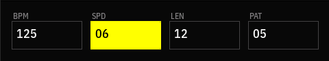
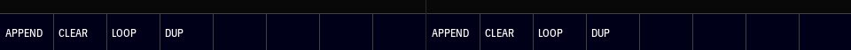
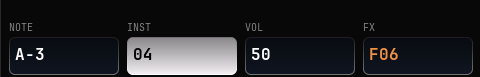
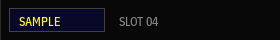
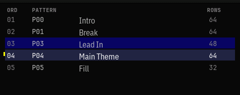

# DSL-Standardisierungs-Review: Custom-Renderer-Inventar und Kandidaten

Stand 2026-07-11, Status-Marker aktualisiert 2026-07-12 (nach
WidgetLab-Rework und Value-Cell-Icons).
Analysebasis: Kit2-Widget-Katalog (`Sources/KontrolSurfaceKit2`),
MK2WidgetLabDemo (`Tools/MK2WidgetLabDemo`), Paulinche-Renderer
(`Sources/PaulincheSurfaceKit`) sowie `Paulinche/BACKLOG.md`
(Sektion „Kit2-DSL-Review").

Zweck: Wo sind wir custom, und welche Elemente sollten durch bestehende,
neu zu parametrierende oder neu zu entwickelnde Standardelemente ersetzt
werden, um DSL-lastiger zu werden. Jeder Punkt trägt ein Kommentarfeld
zum Einzelreview.

---

## 1. Ausgangslage

Kit2 hat einen soliden Widget-Bestand: `ContentText`, `StatusLine`,
`ValueCell`, `ParameterPage`, `FunctionKeyBar`, `Meter`, `WaveformDisplay`,
`SelectionList/Grid`, `ModalDialog`, `ImageElement`, `ProgressBar`,
`TabBar`, `PageIndicator`, dazu Binding-Elemente (`ButtonBinding`,
`EncoderBinding`, `Lamp`, `KeyColor`) und die Shift-Ebene
(`MK2ShiftBranch`, `shiftSlots`). Escape-Hatches: `MK2RenderBlock`
(reines Zeichnen) und `MK2AnyScreenElement` (Zeichnen + Bindings/Lampen).

Die WidgetLab-Regel („If a unit needs something the kit can't express
yet, that capability goes into the kit first", `main.swift:6-9`) wird an
mehreren Stellen nicht gelebt — genau dort entsteht Duplikation zwischen
WidgetLab und Paulinche.

Hardware-Realität als Leitplanke: **Function-Keys existieren nur oben,
4 pro Screen** (F1–F4 links, F5–F8 rechts). Encoder-Zellen sind
bottom-flush, F-Key-Slots top-flush, beide auf demselben X-Raster
(`ScreenLayout.swift:147-167`).

## 2. Custom-Inventar

### 2.1 Paulinche (`Sources/PaulincheSurfaceKit`)

**Pattern**
— Standard: StatusLine (rechts), ParameterPage, ButtonToggleDisplay,
EncoderBinding.
— Custom: linker Screen fast komplett — `drawGridStatusLine` (:182),
`drawChannelHeaders` (:193), `drawPatternGrid` (:208,
Playhead/Cursor/Stripe-Fills, Ruler), `drawTrackerCell` (:239),
`drawPatternOverview` (:284, Minimap).

**Instrument**
— Standard: WaveformDisplay, ParameterPage ×2, FunctionKeyBar
(inkl. Shift), EncoderBinding.
— Custom: Title/Subtitle via FreeType direkt (:115),
`drawKindTag`-Pill (:177), Info-Zeilen (:163).

**Song** *(2026-07-11 komplett entfernt — die Szene war auf mehreren
Ebenen nicht standardkonform, allen voran die Function-Bar unten; eine
künftige SCENE/Arranger-Szene startet frisch und DSL-first.)*
— ~~Standard: RegularScreenDSL (Header/Footer), ProgressBar.~~
— ~~Custom: `drawOrders`-Tabelle, `drawFooterSoftKeys` →
`drawSoftKeyStrip`, `drawParameterSlots` statt ParameterPage.~~

**Splash**
— Standard: FullScreenDSL, ImageElement, ContentText.
— Custom: nur die prozedurale Artwork-*Daten*-Generierung
(`PaulincheSplashArtwork`) — läuft standardkonform über ImageElement.

`PaulincheRendererSupport.swift` (geteilte Custom-Helfer):
`Palette` (~40 RGB565-Farben), `drawSoftKeyStrip` (:45),
`drawParameterSlots` (:67), `drawText`/`drawWrappedText`-Wrapper,
Textstil-Fabriken, `MK2PixelFrame`-Extensions `hline`/`dottedVLine` (:189).

### 2.2 WidgetLab (`Tools/MK2WidgetLabDemo`)

*(Historischer Stand vor dem WidgetLab-Rework 2026-07-12,
`Docs/WidgetLab-Rework-Plan.md`: die Units A–H sind heute per-File-Demos
hinter einem Demo-Browser. Die Font-Lab-Spezimenbank lebt als Type
Specimen/Icon Browser/Dialog Card weiter, das Pattern-Lab als
`TrackerPatternDemo` — die C1-Duplikation besteht dort unverändert.)*

- **Pur-DSL-Vorzeigeeinheiten:** Browser-Lab (B), Meter-Lab (C),
  Selection-Lab (D) — saubere Referenzen.
- **Font-Lab (A):** bewusst Raw-Frame-Spezimenbank (Font-Sweeps,
  Icon-Browser, Dialog-Karten) — akzeptabler Sonderfall.
- **Pattern-Lab (E):** zweites, unabhängig handgebautes Tracker-Grid
  (`trackerGridFrame` :1686, `drawTrackerCell` :1800) samt Minimap
  (`drawPatternOverview` :1890) — dieselben Elemente wie in Paulinche,
  zweimal implementiert.
- **Waveform-Lab (F):** handgebauter Header über `MK2WaveformDisplay`
  in Raw-Frame (:2943), Statuszeile im Escape-Hatch (:2981).
- **Scene-Lab (H):** Escape-Hatch-Inhalte sind Debug-Visualisierungen
  der Layout-Rects — legitimer Escape-Hatch-Einsatz.
- **Keys-Lab (G):** Platzhalter („BUILD ITS WIDGETS INTO KIT2 FIRST").
- WidgetLab definiert `hline`/`dottedVLine` als eigene Extensions
  (:4156) — dieselben wie in PaulincheRendererSupport.

## 3. Empfehlungen

### A. Sofort ersetzbar durch bestehende Widgets

**A1 — Song-Renderer `drawParameterSlots` → `MK2ParameterPageElement`.**
Handgerollter Nachbau dessen, was Pattern- und Instrument-Renderer längst
über das echte Widget beziehen. Klarster Fall im Inventar.

*A1: Die vier Slots (BPM/SPD/LEN/PAT) auf dem rechten Song-Screen — handgerollt statt ParameterPage*

**Erledigt 2026-07-11:** Song-Renderer komplett entfernt; der Punkt ist gegenstandslos.

> Kommentar:

**A2 — Song-Renderer Footer-Softkeys → Standard-`MK2FunctionKeyBarElement`
(top-flush, 4 Slots/Screen).** `drawSoftKeyStrip` zeichnet einen
8-Slot-Strip *unten* auf einem Screen — die Hardware hat die F-Keys aber
nur *oben*, je 4 pro Screen. Der Strip ist damit doppelt nicht-standard
(falsche Kante, falsche Slot-Zahl) und mappt räumlich auf keine Taste.
Kein DSL-Ausbau nötig, sondern Umbau der Song-Szene auf die echte Bar;
bei >4 Aktionen pro Screen: auf beide Screens verteilen oder auf die
Shift-Ebene ausweichen.

*A2: Der Footer-Softkey-Strip der Song-Szene, unten über beide Screens — dort gibt es keine physischen Tasten*

**Erledigt 2026-07-11:** Song-Renderer komplett entfernt; der Punkt ist gegenstandslos.

> Kommentar:

**A3 — Pattern-Renderer `drawGridStatusLine` → `MK2StatusLineElement`.**
Feste x-Positionen mit Einzeltexten ist exakt dessen Modell; der rechte
Screen nutzt `MK2StatusLine` bereits.
**Erledigt 2026-07-12:** Grid-Statuszeile ist ein `MK2StatusLineElement`
(neue Parametrierung: `MK2StatusLineItem.maxWidth` clippt Freitext-Items);
der rechte Edit-Screen verlor dabei auch seinen Escape-Hatch — Statuszeile
+ Instrument-Label als Element, Trennlinie als `MK2SeparatorElement`.
Pixel-identisch per Snapshot-Vergleich.

*A3: Die handgebaute Statuszeile des Pattern-Grids (PAT/ROW/PLAY/Position)*

> Kommentar:

**A4 — Instrument-Renderer Title/Subtitle → `MK2ContentText`** statt
direkter FreeType-Aufrufe über `Support.drawText`.
**Erledigt 2026-07-12:** Title/Subtitle sind `MK2ContentText` mit
`.custom(weight:pixelSize:)`-Rolle (gleicher `MK2HIG.textStyle`-Pfad,
pixel-identisch per Snapshot-Vergleich).

*A4: Title/Subtitle des Instrument-Editors („PULSE LEAD" / „EDIT 04 SAMPLE") — direkte FreeType-Aufrufe*

> Kommentar:

**A5 — `hline`/`dottedVLine` ins Kit heben.** Beide Codebases definieren
identische private `MK2PixelFrame`-Extensions. Primitiven auf
`fill`-Niveau — gehören neben `stroke` in `PixelFrame.swift`.
**Erledigt 2026-07-12:** `hline`/`dottedHLine`/`dottedVLine` sind
öffentliche `MK2PixelFrame`-Primitiven; die privaten Duplikate in
WidgetLab und PaulincheSurfaceKit sind entfernt. Obendrauf beschlossen
und gebaut: `MK2SeparatorElement` (R1–R4: Border-Linie, Akzent-Linie,
gepunktet, Band-Kante — vertikale Ruler bleiben PatternGrid-intern) und
der `header:`-Slot am FullScreen-DSL-Root (`.status` fixed-pitch,
`.title` proportional, `.none` für Spezialfälle).

> Kommentar:

### B. Bestehende Widgets neu parametrieren

**B1 — Encoder-Touch-Highlight als DSL-Default** in
`MK2ParameterPageElement`/`MK2EncoderBindingElement`, mit Opt-out.
Backlog-Kandidat, durch die Analyse bestätigt: Der Pattern-Editor baut
den `.encoderTouch`→App-State→`isFocused`-Roundtrip nach, der
Instrument-Editor nicht (kein Highlight), und
`SurfaceUIState.touchedEncoderIndex` existiert als dritte, von niemandem
konsumierte Inkarnation. Die Runtime kennt den Touch-Zustand lokal —
das Highlight kann wie die Shift-Ebene ohne App-Roundtrip aus der DSL
kommen.

*B1: Die Edit-Zellen des Pattern-Editors; die invertierte INST-Zelle ist das Touch-Highlight, das jede Szene selbst nachbauen muss*

**Design (beschlossen 2026-07-11):** Zwei Ebenen, eine Optik.

- *Ebene 1 — `focus` (App-deklariert, persistent):* bleibt das bestehende
  `isFocused` pro Slot; Modell-Zustand („dieses Feld wird editiert"),
  gehört der App. Der Pattern-Editor treibt es weiter aus `cursor.field`.
- *Ebene 2 — `touch` (Runtime-eigen, ohne App-Roundtrip):* neu, pro Slot
  parametriert über `MK2EncoderSelectionBehavior`:
  `.none` (Opt-out, nur App-`isFocused`), `.momentary` (Highlight
  solange berührt — Default für encoder-gebundene Slots) und
  `.latched` (zuletzt berührter Slot bleibt selektiert, bis ein anderer
  berührt wird — ersetzt die `focusedFilterEncoder`-Handarbeit des
  Browsers).
- *Eine Erscheinung:* Gerendert wird `isFocused || isTouched` mit den
  bestehenden `focused*`-Tokens aus `MK2ValueCellColors`. Keine eigene
  Touch-Farbe — das transiente Highlight überbrückt den App-Roundtrip
  unsichtbar: Touch invertiert sofort (Runtime), die App bestätigt per
  `isFocused` in der nächsten Projektion, optisch ändert sich dabei
  nichts. Amber bleibt SHIFT vorbehalten.
- *Mechanik:* Wie SHIFT aus vorbereiteten Pixeln — `present()` erhält
  fertige Frames, die Runtime kann den DSL-Build nicht wiederholen.
  Der Build rendert deshalb pro Slot ein „berührt"-Patch
  (Slot-Rechteck, ~110×38 px) in die Szene; die Runtime blittet es bei
  Touch lokal und stellt beim Release aus dem Basis-Frame wieder her.
  Latenzfrei, der Reconciler überträgt nur das Slot-Band. Während
  gehaltener SHIFT-Ebene sind Touch-Overlays unterdrückt (die
  Shift-Slots zeigen andere Werte).
- *Bewusst nicht:* eigene Touch-Farbe, Release-Linger (erst bei
  nachgewiesenem Flackern), Double-Touch-Semantik (separates Thema;
  inzwischen ebenfalls geliefert: `defaultValue`-Reset via Double-Touch).
- *Migration:* Instrument-Editor erhält das Highlight per Default
  gratis; Pattern-Editor behält `isFocused` und verdrahtet `selectField`
  über den bestehenden `encoderTouch`-Pfad; Browser-Filter ziehen auf
  `.latched` um; `SurfaceUIState.touchedEncoderIndex` (nie konsumiert)
  entfällt ersatzlos.

**Umgesetzt 2026-07-11/12:** `MK2EncoderSelectionBehavior`
(`.none`/`.momentary`/`.latched`), vorbereitete Touch-Overlays in
`MK2ScreenBuildResult`, Runtime-Blit in `MK2Surface2`; Paulinche-Editoren
und Browser-Filter migriert, `SurfaceUIState.touchedEncoderIndex` entfernt.
Auf Hardware getestet (flackerfrei).

> Kommentar:

**B2 — `ValueCell`-Familie um Tag/Chip-Erscheinung ergänzen** (oder
Mini-Widget `MK2TagElement`): deckt den `drawKindTag`-Pill im
Instrument-Renderer ab (SAMPLE/WAVETABLE).
*(Verwandt, 2026-07-12 geliefert: die ValueCell-Familie trägt jetzt
semantische Label-Icons — `iconGlyph`/`iconPosition`,
`MK2HIG.IconGlyph`, Regel im CLAUDE.md. Der Tag/Chip selbst steht noch
aus.)*

*B2: Der „SAMPLE"-Pill (drawKindTag) — rounded fill + stroke von Hand*

> Kommentar:

**B3 — `SelectionList` um Spalten erweitern.** Die Order-Tabelle des
Song-Renderers (Index/Pattern/Titel/Rows, Selektions-Fill,
Playback-Marker) ist strukturell eine SelectionList mit Spalten statt
Icon+Badge. Eine `columns:`-Parametrierung erspart ein eigenes
Table-Widget und gäbe der Song-Szene gratis die vorhandene
`MK2SelectionInputElement`-Navigation (Jog/Encoder, Lampen).

*B3: Die Order-Tabelle der Song-Szene — strukturell eine SelectionList mit Spalten*

**Teilweise erledigt 2026-07-11:** Der Song-Renderer (einziger Nutzer der Order-Tabelle) ist entfernt. Die `columns:`-Parametrierung bleibt als Anforderung für die künftige SCENE/Arranger-Szene bestehen.

> Kommentar:

### C. Neu zu entwickelnde Widgets

**C1 — `MK2PatternGridElement` (Tracker-Grid) und
`MK2OverviewScrollbarElement` (Minimap).** Stärkstes Argument ist die
Duplikation: Grid, Zellen-Triaden, Playhead/Stripe-Fills, Ruler und
Minimap existieren zweimal (WidgetLab ↔ Paulinche). Nach der
WidgetLab-Regel gehört das ins Kit. Datenmodell ist mit
`MK2PaulinchePatternCell` faktisch definiert — es fehlt die Heimat.
Die Minimap ist separat wiederverwendbar (jede scrollende Szene).

*C1: Das Tracker-Grid (links) mit Minimap am rechten Rand — existiert so doppelt in WidgetLab und Paulinche*

> Kommentar:

**C2 — Kein neues Widget für den Splash.** Prozedurale
Artwork-Generierung ist *Daten*-Erzeugung über das standardkonforme
`MK2ImageElement` — bereits das richtige Muster.
> Kommentar:

### D. Kit-interne Hygiene (beim Umbau mitnehmen)

**D1 —** `insetBy`, `scale565`/`scaled`, `drawRoundedPanel`,
Wrap-Helper sind privat über
ScreenDSL/ScreenLayout/ValueCell/Meter/ModalDialog/SelectionView
dupliziert — einmalig konsolidieren.
> Kommentar:

**D2 —** Hartcodierte deutsche Strings in `ModalDialog`
(„4D: Auswahl und Bestätigung", „AKTIONEN") und `SelectionView`
(„Keine Einträge") — spätestens bei einer Kit-Öffnung ein Thema.
**Erledigt 2026-07-12** (im Zuge des „alles auf Englisch"-Beschlusses):
ModalDialog spricht „4-D: select and confirm"/„ACTIONS", SelectionView
„No entries"; auch die Tracker-Demo-Modaltexte sind englisch.
> Kommentar:

## 4. Verzahnung mit dem Backlog-Review

Die Backlog-These („Bindings und Lamp-States sind nicht genug
formalisiert") wird gestützt, aber das Display-Inventar zeigt: Die
Widget-Seite ist weiter als die Binding/Lampen-Seite. Empfohlene
Reihenfolge:

1. **A1–A5** — risikolos, baut Support-Code ab.
2. **B1** (Touch-Highlight in die DSL) — löst den dreifach
   halb-verdrahteten Roundtrip, passt zum gelieferten Shift-Muster
   („Runtime-lokal, ohne App-Roundtrip").
3. **B2/B3** opportunistisch, wenn die jeweilige Szene angefasst wird;
   B3 idealerweise *vor* der SCENE/Arranger-Hardware-Szene aus dem
   Backlog, damit die nicht als dritter Custom-Renderer startet.
4. **C1** als eigener Schritt — größter Brocken, beseitigt die größte
   Duplikation.
5. Parallel die offenen Backlog-Punkte: ~~per-Ebene-Lampen (lügende
   UNDO-Lampe)~~ und ~~`isHardwareShiftPressed`-Abbau~~ (beide erledigt
   2026-07-11); offen bleibt das `ControlLampName`-Enum mit typisierten
   Bindings — die Analyse liefert dafür die vollständige
   Lampen-/Binding-Landkarte.

## Anhang: Verworfene Ideen

- **`FunctionKeyBar` mit `edge: .bottom`** — verworfen: Die Hardware hat
  Function-Keys nur oben; eine Bottom-Variante würde Labels ohne
  räumlich zugeordnete Taste erzeugen. Der Footer gehört Encoder-Zellen
  (bottom-flush, gleiche X-Slots), nicht F-Key-Labels. Stattdessen A2.
