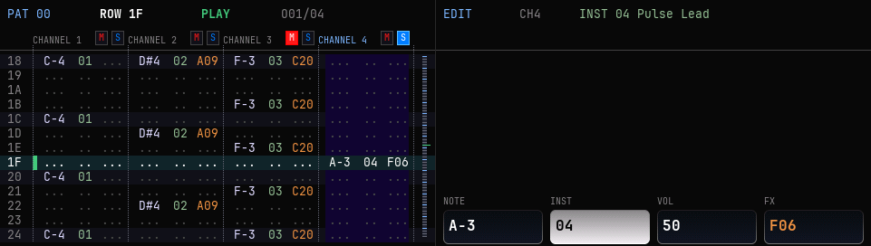

# DSL-Standardisierungs-Review

Review von 2026-07-11, abgearbeitet bis 2026-07-13. Umgesetzt sind die
Empfehlungen A1–A5, B1, B2, B3 und D2 (A1/A2 wurden durch die Entfernung des
Song-Renderers gegenstandslos), dazu backlog-seitig die per-Ebene-Lampen, der
`isHardwareShiftPressed`-Abbau und das `ControlLampName`-Enum. Die vollständige
Analyse und die erledigten Punkte stehen in der git-Historie dieses Dokuments.

**Offen bleiben nur C1 und D1.**

## C1 — Tracker-Grid + Minimap ins Kit

`MK2PatternGridElement` (Tracker-Grid) und `MK2OverviewScrollbarElement`
(Minimap). Stärkstes Argument ist die Duplikation: Grid, Zellen-Triaden,
Playhead/Stripe-Fills, Ruler und Minimap existieren zweimal — im WidgetLab
`TrackerPatternDemo` und im Paulinche `PaulinchePatternRenderer`, metrisch
identisch (Statuszeile y8, Channel-Header y38, Grid-Rule y55, gridTop 60,
rowHeight 16, channelXs [48,153,258,363], rulerXs [36,141,246,351,456]). Nach
der WidgetLab-Regel gehört das ins Kit. Das Datenmodell ist mit
`MK2PaulinchePatternCell` faktisch definiert — es fehlt die Heimat. Die Minimap
ist separat wiederverwendbar (jede scrollende Szene). Der größte Einzelbrocken;
beseitigt die größte verbliebene Custom-Renderer-Duplikation.

## D1 — Kit-interne Helfer-Konsolidierung

`insetBy`, `scale565`/`scaled`, `drawRoundedPanel` und die Wrap-Helper sind
privat über mehrere Kit-Dateien dupliziert (ScreenDSL, ScreenLayout, ValueCell,
Meter, ModalDialog, SelectionView, DialogCard, Tag, FunctionKeyBar) — einmalig
in eine geteilte Stelle konsolidieren.

## Anhang: Verworfene Ideen

- **`FunctionKeyBar` mit `edge: .bottom`** — verworfen: Die Hardware hat
  Function-Keys nur oben; eine Bottom-Variante würde Labels ohne räumlich
  zugeordnete Taste erzeugen. Der Footer gehört Encoder-Zellen (bottom-flush,
  gleiche X-Slots), nicht F-Key-Labels.
