# Füllhorn — a greenfield visual direction

**Status: decided — Füllhorn is the next HIG** (bench decision 2026-07-23:
"100%, ich möchte mit Füllhorn als HIG gehen"). Execution is deliberately
deferred: the full renewal starts once the interaction concept carries and
every dialog exists on both app and hardware, so the redesign works from the
complete UI vocabulary — all verbs and adjectives — instead of guessing it.
Until then the shipped identity remains `Docs/HIG.md` (Aurora Graphite) and
no further design rounds happen; feature work has priority.

All renderings are pixel-honest: 480×272, the identity fonts, every gradient
Bayer-4×4-dithered and RGB565-quantized. What you see here is byte-for-byte
what the OLEDs showed during the bench rotation. Reproduce with
`python3 Docs/images/fuellhorn/render.py` (screens 1–6) and `render2.py`
(screens 7–10).

---

## 1. Thesis

**Structure without chrome.** No bands, no wells, no rings, no cards. Two
systems replace them:

1. **Zone hues** — every functional area owns a color family, shaded as
   dithered tint fields (hue → black). The field *is* the mode indicator.
2. **Editorial typography** — hierarchy comes from extreme size contrast
   (96px heroes against 9px tracked micro-caps), not from boxes around
   things.

Color is never decoration: it is either a **zone** (where am I), an
**object** (which channel/item), or a **signal** (clip, warning, playhead).

## 2. The two screen laws

**Field-hero screens** — screens with exactly one thought (an identity, a
value, a question) put it huge over a full-surface tint field:

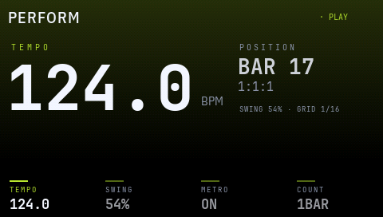
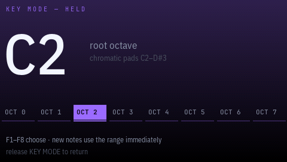
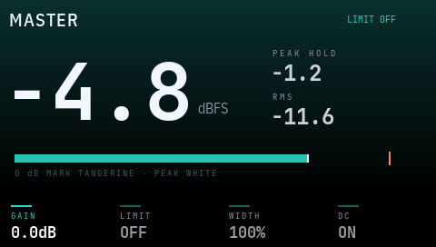
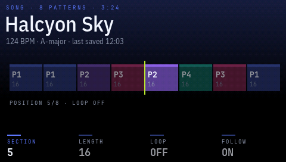
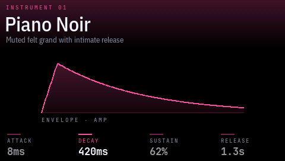
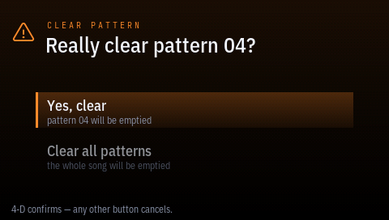

**Density screens** — grids and lists keep the true-black canvas; color
appears only punctually (zone title, selection, playhead, object coding).
A field behind dense content would fight it for contrast:

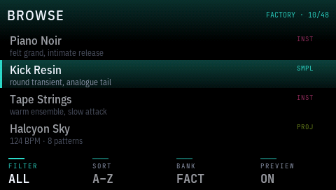
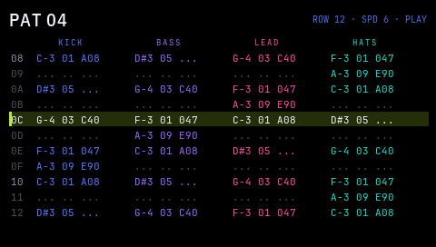
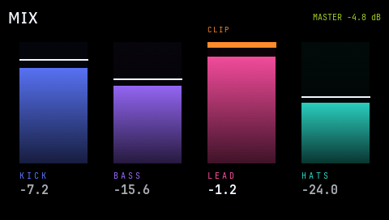
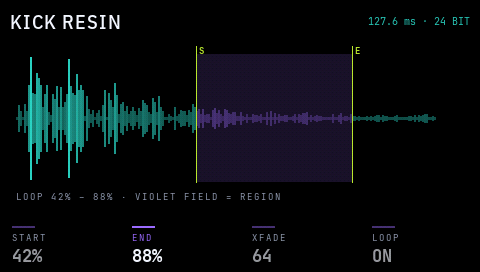

## 3. Color

### 3.1 Zone hues

sRGB design values with their RGB565 quantizations (5/6/5 floor+dither):

| Zone | Hue | sRGB | RGB565 | Meaning |
| --- | --- | --- | --- | --- |
| Browse / navigation | Petrol | #2BD9C8 | 0x2ED9 | lists, library, sample views |
| Pattern / sequencing | Ultramarin | #5C78FF | 0x5BDF | tracker, song, arranger |
| Loop / region | Violett | #9B6BFF | 0x9B5F | loop fields, held setting popups |
| Instrument / sound | Magenta | #FF4FA3 | 0xFA74 | instrument editor, sound identity |
| Transport / live | Lime | #B8E62E | 0xBF25 | playhead, position, tempo, run state |
| Warning / clip | Tangerine | #FF8A2B | 0xFC45 | destructive prompts, clip caps, 0dB marks |

Text neutrals: Paper #F2F6FF (primary), Dim #8A93A8 (secondary), Faint
#4A5060 (tertiary/empty).

### 3.2 Object colors

Channels, items and sections carry their own identity hue (the MASCHINE
factory-UI lesson, [HIG ledger proposal]): KICK ultramarin, BASS violett,
LEAD magenta, HATS petrol in the mocks. Object color appears in channel
headers, note text, mixer fills, section blocks and list-kind badges — it is
data coloring, orthogonal to the zone hue.

### 3.3 Shading recipes

Everything below is linear in float, then Bayer-4×4-dithered into RGB565 —
never per-row quantization.

| Element | Recipe |
| --- | --- |
| Zone tint field | `hue × t`, t linear from 0.20–0.30 at the top edge to 0 at 60–100% height, composited with `max()` over black |
| Selection field | same, 0.30 → 0.08 over the row height, plus a 2–3px solid hue bar on the left edge |
| Meter fill (mixer) | level = fill height, loudness = *brightness ramp of the object hue* (0.95 at the top of the fill → 0.25 at the bottom); no green/yellow/red |
| Clip cap | solid Tangerine bar capping the meter; peak line 1px Paper |
| Loop region | Violett at constant 0.16 over the wave, region markers Lime |
| Envelope fill | hue polygon at 0.30, faded vertically to 0.25× toward the baseline, 2px hue stroke on top |

## 4. Typography — the answer to "I see new fonts"

There are **no new fonts**. Every glyph is IBM Plex Sans Condensed
(Regular/Medium), JetBrains Mono (Regular/Bold) or Phosphor — the identity
faces. What reads as new faces is the same duo in five previously unused
roles:

| Role | Face | Size / treatment | Where |
| --- | --- | --- | --- |
| **Hero numeral** | JetBrains Mono Bold | 78–96px | "124.0", "−4.8" — tabular digits at display size read like a dedicated numeral face |
| **Hero glyph** | Plex Medium | 96px | "C2" in the key-mode popup |
| **Display title** | Plex Medium | 34–36px | "Piano Noir", "Halcyon Sky" |
| **Screen title** | Plex Medium | 20px, caps, +1px tracking | "BROWSE", "MASTER" |
| **Micro caps** | JetBrains Mono Regular | 9–10px, caps, **+2–3px letter tracking** | zone metas, knob labels, annotations — the tracking makes it read like a separate condensed display face |
| Value | JetBrains Mono Bold | 17px | knob-row values |
| Body / detail | Plex Regular | 12–13px | descriptions, hints, footnotes |

Two rules carry the effect: **scale contrast of at least 1:8** between a
screen's hero and its micro caps (96 vs 9–10px), and **tracking only at
micro size** — caps with wide tracking exist below 11px exclusively; titles
track at most +1px. That contrast is what the eye parses as "another font",
and it is the strongest argument for the direction: the identity duo covers
it without adding a face.

## 5. Component details

**Selection bar** (browse, dialog): tint field over the full row + 2–3px
solid hue bar flush left + type promotion (Paper instead of dimmed, detail
line one step up). No ring, no inversion.

**Knob row** (the encoder mapping with minimum chrome): per slot a 22×2px
**color tick**, a tracked micro-caps label, and a 17px Mono Bold value.
Focus = full-brightness tick + hue label + Paper value; unfocused ticks run
at 45% hue, values at 62% Paper. The tick row sits at the same slot x-grid
as the physical encoders.

**Edge-lit blocks** (the "3D pattern blocks" in the song screen): a block is
an object-hue tint fill (~16–64% by state) with a **3px solid hue top
edge**. That top light-edge is the single surviving depth cue of the whole
direction — consistent with the shared top-left light source — and makes
the blocks read subtly raised without any bevel machinery. Active block:
full-brightness edge + brighter fill + Paper label; inactive: 40% edge,
faint fill, dimmed label.

**Slot stripe** (the "abgesetzter Dekostreifen" under the root-octave
selector): each F-slot carries a detached 2px hue stripe **below** its
label, separated by a 2px gap — an echo of the physical F-button sitting
above the display, reduced to a tick. Selected slot: label inverts onto a
solid hue chip *and* its stripe runs at full brightness; unselected stripes
idle at 30%. The stripe row doubles as the only horizontal structure line a
Füllhorn screen has.

**Brightness-as-level meters**: level is fill height, loudness is hue
brightness, clip is a Tangerine cap, peak a 1px Paper line. Semantic zones
(warn thresholds) exist only at the moment they trigger — no permanent
traffic-light bands.

**Playhead**: always Lime, always a field + 2px edge, in every zone.

## 6. What Füllhorn keeps, breaks, and risks

Keeps from the canonical HIG: true-black base for density, identity
typography, dither discipline, the layout physics (labels at their physical
controls, bottom-flush knob mapping, top F-slots), metric ink centering.

Breaks deliberately: the §6 material vocabulary (no raised/debossed
machinery — depth exists only as the edge-lit top line), the meter
traffic-light convention, the 80/15/5 budget (Füllhorn runs nearer
60/25/15), and the wash prohibition — **zone fields are washes with
semantics**. That prohibition was written against *decorative* washes;
whether a semantic field earns its raised black level is exactly what the
bench must judge per screen.

Risks to watch on the OLEDs: micro-caps legibility on fields at 9px,
field milkiness at shallow viewing angles, and channel-hue meters being
harder to scan than the traffic light under stage light.

## 7. Adoption paths

1. **Graft** (low risk): object colors, the knob-row tick form, edge-lit
   blocks and the slot stripe are compatible with Aurora today and could
   enter the canonical HIG as elements.
2. **Perform split**: Aurora stays the editing identity; Füllhorn becomes
   the performance/overlay language (field-hero screens are all
   perform/modal moments already).
3. **Full succession**: Füllhorn replaces Aurora as the system — the
   largest step; requires re-benching every density screen and the meter
   convention.

## Appendix: contact sheets

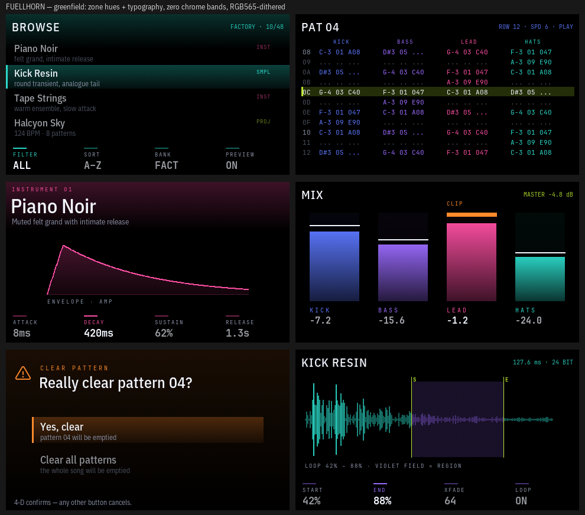
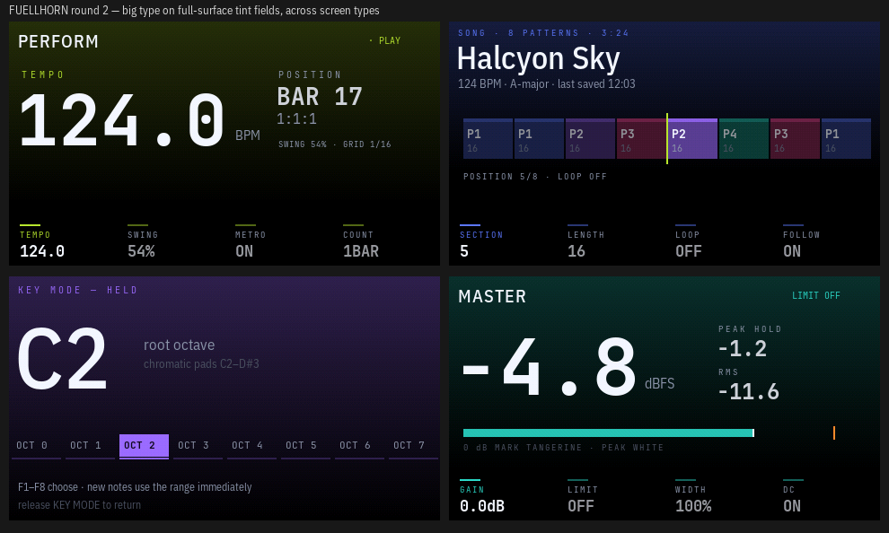
