# Hardware UI Human Interface Guidelines

Canonical specification for everything rendered on the two 480×272 OLED
displays (Komplete Kontrol MK2, MASCHINE MK3) through `KontrolSurfaceKit2`.
Code is the source of truth for exact values — every table cites the constant
it mirrors, and a change must land in both places in the same commit. The
current visual direction is **Aurora Graphite** (design review 2026-07-22,
partially adopted; see [Adoption status](#adoption-status)).

Companion documents: `Docs/Held-Command-Bar.md` (command/setting popups),
`Docs/automation-testing.md` (snapshot verification), `CLAUDE.md`
(interaction invariants, condensed from this document).

All renderings below are unretouched Widget-Lab snapshots (RGB565, real
fonts, both screens side by side with a 1px seam), regenerated with
`WIDGET_LAB_SNAPSHOT_DIR=<dir> widget-lab`.

---

## 0. Orientation — if you are new here

The hardware: Komplete Kontrol S-Series MK2 keyboards and MASCHINE MK3
carry **two 480×272 RGB565 OLED displays**, eight buttons above and eight
encoders below them, plus a 4-D navigation wheel. The `ccd` daemon owns
the USB device; applications never talk USB — they declare *scenes*
through **KontrolSurfaceKit2** ("Kit2"), the middleware this document
specifies.

The mental model in sixty seconds: a scene is two screens plus input
bindings plus button lamps. Screens are composed declaratively from the
elements in §8, framed by the chrome in §7; every color is a token from
§3, every text a role from §4, every depth cue one of the four treatments
in §6. Nothing is styled ad hoc.

A minimal screen, taken from the real Meter demo:

```swift
MK2RegularScreenDSL(
    header: .title(title: "Meter", subtitle: styleSubtitle),
    footer: .hint(footerHint)
) {
    MK2ContentText("Meter Elements", x: 8, y: 0, role: .title)
    MK2MeterElement(
        channels: [MK2MeterChannel(label: "L", level: level, peak: peak)],
        rect: MK2PixelRect(x: 8, y: 112, width: 420, height: 34),
        style: .protracker
    )
}
```

Where things live:

| You want | Go to |
| --- | --- |
| every color/typography/geometry token | `Sources/KontrolSurfaceKit2/MK2HIG.swift` |
| chrome bands, layout, content rects | `ScreenLayout.swift` (`MK2ScreenLayout`, `MK2RegularScreenChrome`) |
| one element | one file — `Meter.swift`, `SelectionView.swift`, `ValueCell.swift`, … (§8 cites each) |
| a live playground | `widget-lab` (`make widget-lab-sim` starts it against the simulator; 4-D browses, SCENE exits) |
| renderings without hardware | `WIDGET_LAB_SNAPSHOT_DIR=<dir> widget-lab` writes every demo as PNG |
| what the real panels show | `Scripts/kk-screenshot.py` (or the `kk-screen` skill); `Scripts/kk-display.py` pushes PNG previews *to* the panels |

House rules you will meet immediately: compose only from public Kit2 API
(if a demo needs something new, the capability goes into the kit first);
never hand-tune vertical text/icon positions — measured ink centers on
measured anchors (`FreeTypeTextRenderer.inkExtent`, `MK2IconAlignment`),
a literal pixel nudge is a defect; and every visual change updates this
document and its gallery in the same commit.

## 1. Principles

1. **True-black canvas.** `0x0000` means pixels off — the OLED's contrast
   anchor. Scene backgrounds stay at or near black
   (`MK2HIG.Chrome.background` 0x0841 at the brightest); tinted surfaces
   exist only *inside* raised or debossed elements, never as full-screen
   washes or vignettes.
2. **One light source, top-left.** Raised elements carry a lit top edge and
   a dark bottom shadow; debossed elements the inverse. No element may
   contradict this — depth cues that disagree destroy all of them.
3. **Color is meaning.** Roughly 80% neutral surfaces, 15% structuring
   cool tones, at most 5% signal color. Every accent has a semantic role
   (§3); color used as decoration is a defect.
4. **Dithered gradients only.** Per-row RGB565 lerps band visibly on the
   OLED. Every ramp runs through `MK2OrderedDither` (or the gradient tile
   cache via `fillRoundedVerticalGradient`). Shadows and edges are hard,
   1–3px; soft glows and large blurs do not exist in this vocabulary.
5. **Identity typography is non-negotiable.** IBM Plex Sans Condensed for
   proportional UI, JetBrains Mono for fixed-pitch, Phosphor for icons —
   nothing else, on hardware or in mockups that claim to represent it.
6. **Geometry stability.** Deterministic rendering, stable layout across
   state changes, labels directly above/below the physical control they
   describe. A mode change may never relocate a frequent action.
7. **Bench approval decides.** PNG snapshots gate a change; the physical
   OLED (contrast, viewing angle, dither visibility) has the final word.
   Constants record their history so a tuning round can be retraced.

## 2. Displays and layout

Two 480×272 panels, RGB565 big-endian, separated by a physical bezel gap.
Left display: dense context (tracker, pattern, lists). Right display:
focused edit surface. Full-bleed artwork spanning both panels must account
for the calibrated bezel gap (see the Panorama demo).

Layout tokens (`MK2ScreenLayout`):

| Token | Value | Meaning |
| --- | --- | --- |
| `bounds` | 480×272 | one display |
| `margin` / `contentInset` | 8 | outer margin, content inset |
| header height (`.title`, `.status`) | 28 | `captionPixelSize × 2 − 2` (32 until the 2026-07-23 header diet); leading subtitle adds `captionPixelSize + 2`. Header text centers its cap band metrically on the band — never by formula |
| hint footer height | 25 | `footnotePixelSize + 12` |
| `encoderFooterHeight` | 57 | derived: slot 33 + bottom inset 2 + label 13 + gap 3 + 6 — never a literal |
| `encoderSlotXs` | 8, 126, 244, 362 | four bottom-flush slots per display |
| `encoderSlotWidth` × `Height` | 110×33 | value well size (38 until the 2026-07-23 chrome diet; filter cells share the slot height) |
| `MK2ScreenProgressBar.height` | 2 | top or bottom placement |
| content rect (title + hint) | 8,33 → 464×207 | `contentRect` for the regular layout |

Encoder cells are **bottom-flush** (E5–E8 under the right display, E1–E4
top-flush channel encoders in the tracker scene); function-key labels are
**top-flush** under the physical F1–F8 buttons, on the same uniform slot
grid. The footer height derives from its content — reintroducing fixed
literals is a defect.

## 3. Color

All values are RGB565; sRGB equivalents are decoded (5/6-bit expanded), not
design-time inputs.

### 3.1 Chrome (`MK2HIG.Chrome`) — the shipped identity

| Token | RGB565 | sRGB | Role |
| --- | --- | --- | --- |
| `background` | 0x0841 | #080808 | scene background (near-black) |
| `headerFill` | 0x18e3 | #181c18 | raised band fill (neutral graphite) |
| `headerTopLine` | 0x632c | #636563 | lit top edge of raised bands |
| `headerBottomLine` | 0x0000 | #000000 | band bottom shadow (true black) |
| `text` | 0xffff | #ffffff | primary text |
| `dim` | 0x8410 | #848284 | secondary text |
| `accent` | 0x7dbf | #7bb6ff | navigation, focus, call to action |
| `destructive` | = `Palette.warn` | #ffb252 | destructive command labels — one warn-family amber since 2026-07-23 (was 0xec88; the tracker FX column keeps its own 0xec88, which is syntax coloring, not a warning) |
| `shiftAccent` | 0xfc00 | #ff8200 | SHIFT-layer-only labels |
| `border` | 0x4208 | #424142 | neutral borders, well rings |
| `footerFill` | 0x1083 | #101018 | footer band fill |
| `progressFillStart/End` | 0x1294→0x465f | #1051a5→#42cbff | progress ramp — ambient state, deliberately not the accent |

### 3.2 Aurora semantic palette (`MK2HIG.Palette`) — bench-pending

Color carries meaning, never decoration. These tokens exist but are **not
yet** wired into `Chrome`; adoption is per-role, per-scene, after bench
approval.

| Token | RGB565 | Source sRGB | Role |
| --- | --- | --- | --- |
| `navigation` | 0x563f | #55c7ff | navigation and focus. **Not** replacing `Chrome.accent`: bench 2026-07-23 (side-by-side and flip-flop on the OLEDs) found the two indistinguishable in situ — the recolor buys nothing. Reserved for future semantic splits (e.g. navigation vs. focus) |
| `loop` | 0x735f | #7668ff | loop/region marking — **not** focus (resolved against the review, which overloaded violet) |
| `confirm` | 0x6737 | #63e6be | confirmations, structural markers |
| `warn` | 0xfd8a | #ffb454 | **the** warning amber (adopted 2026-07-23): modal warning severity, destructive command labels (`Chrome.destructive` aliases it). Verified distinguishable from `shiftAccent` side by side on the OLEDs — the four historical amber tones (0xec88, 0xfe00, shift, warn) collapsed to these two |
| `clip` | 0xfb6d | #ff6d6d | clipping/limits exclusively |

### 3.3 Meter (`MK2HIG.Meter`) and Waveform (`MK2HIG.Waveform`)

Meter zone colors: `normal` 0x07e0 (green), `warning` 0xffe0 (yellow),
`danger` 0xf800 (red). ProTracker style: track 0x0000, border 0x8410,
yellow at 0.52, red at 0.82 of scale. Ballistics are hardware-approved
(2026-07-13): release 360ms, peak hold 300ms, peak fall 1500ms, reference
50fps, decay floor 0.1, silence threshold 0.003.

Waveform tokens mirror the Paulinche app (`Design.Waveform` /
`Design.Accent`, quantized): background 0x0000, trace 0x357f (#31aeff),
outside-region trace 0x1a6e, region fill 0x08a4, region edge 0xb69d, marker
green 0x56cd, playhead 0xdedb, corner radius 6. **Hardware and app render
sample material in one identity — change both sides together.** An Aurora
recolor of the waveform (cyan→cobalt ramp) therefore requires a joint
decision; it is not adopted.

## 4. Typography

Faces (`MK2HIG.Fonts`): **IBM Plex Sans Condensed** (Regular/Medium),
**JetBrains Mono** (Regular/Bold), **Phosphor Regular** (icons). Rendering:
FreeType/HarfBuzz, grayscale-hinted. Repeated text stays in the glyph/run
caches.

| Role | Face/weight | Size (px) | Use |
| --- | --- | --- | --- |
| `title` | Plex Medium | 24 | dialog/screen titles |
| `body` | Plex Regular | 16 | lists, dialogs, settings |
| `caption` | Plex Medium | 15 | header bands, captions |
| `footnote` | Plex Regular | 13 | hint footers, footnotes |
| dialog icon | Phosphor | 48 | action-dialog icon |
| `grid` | JetBrains Mono | 13 (cell 8×16) | tracker/grid content |
| `label` | JetBrains Mono | 10 (cell 6×13) | well labels, meter labels |
| `readout` | JetBrains Mono Bold | 16 (cell 10×20) | value wells |

Fixed-pitch is for tracker/grid/value content; proportional for everything
else. Mixed-face lines align on the **baseline**, never the top edge.
User-visible text uses real typography ("…", locale quotes); source code,
logs and protocol strings use plain ASCII punctuation.

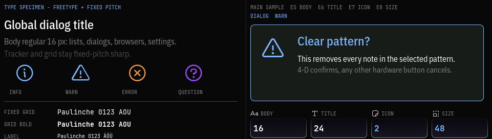
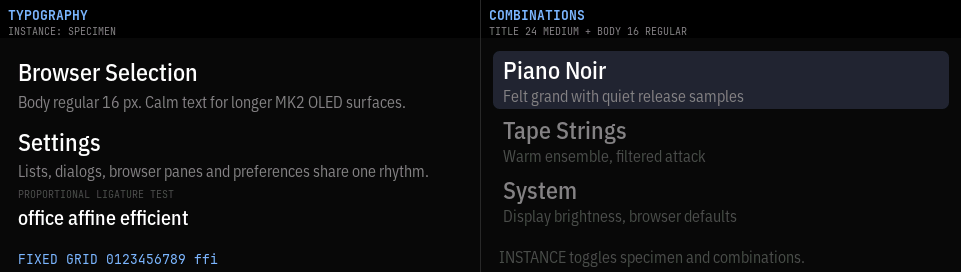

*Code:* `MK2HIG.swift` (`Fonts`, `Typography`, `SurfaceFontMetrics`), `Fonts/SurfaceFont.swift`, `FreeType/FreeTypeTextRenderer.swift` · *Demo:* `type-specimen`

## 5. Iconography

Phosphor Regular only, via curated `MK2HIG.IconGlyph` cases (grown on
demand from `Tools/WidgetLab/PhosphorIcons.regular.json`); never raw
`\u{…}` escapes at call sites. Label-line icons render in their own tint
(`MK2ValueCellColors.icon`, default: lightened label color), never the
label color. One icon position (leading or trailing) per screen — never
mixed. Icons name the parameter's semantics; the physical control is
identified by position, so labels never say "E3".

**Vertical placement is metric-driven, never hand-nudged**
(`MK2IconAlignment`, 2026-07-23). Phosphor ink sits on the baseline and
fills its em asymmetrically, so centering the layout box hangs every icon
visibly high. The rules:

- An icon beside a text line centers its *measured ink*
  (`FreeTypeTextRenderer.inkExtent`, baseline-relative, run-cached) on the
  line's **cap band center** (`capBandCenter` — baseline − cap height/2,
  probed via "H"); works for proportional lines and `BitmapLabel` mono
  lines alike.
- An icon alone in a panel or cell centers its ink on the panel's
  mid-height (`iconTop(centeredOn:)`).
- An icon beside a multi-line text block centers its ink on the block.

Both cap band and ink extents come from the fonts, so a face or size
change re-centers every use without retuning. New drawing code must route
through `MK2IconAlignment`; a literal pixel nudge next to an icon draw is
a defect.

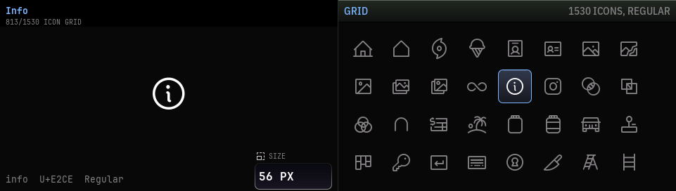

*Code:* `MK2HIG.swift` (`IconGlyph`), `IconAlignment.swift` · *Demo:* `icon-browser`

## 6. Material and depth vocabulary

Exactly four depth treatments exist. Anything else (soft glow, drop
shadow, blur, vignette) is out of vocabulary.

| Treatment | Recipe | Where |
| --- | --- | --- |
| **Raised band** | fill `headerFill`, 1px `headerTopLine` top edge, 1px true-black bottom shadow | footers, function-key chips |
| **Debossed band** | the raised band's light curve inverted: shadow edge on top, fill rising toward a 1px lit edge that faces the content | headers (since 2026-07-23) — together with the raised footer, both lit edges frame the content plane and the chrome recedes at both screen edges |
| **Debossed well** (`MK2HIG.Well`) | border ring top×0.35 → bottom×2.1, interior fill top×0.5 → bottom×1.35, both dithered | value cells, filter cells |
| **Selection highlight** (`MK2HIG.Selection`, `drawSelectionHighlight`) | 1px accent ring, interior gradient top×1.5 → bottom×0.72 over the shared base tone `Selection.fill` (0x2126), 1px light edge (×2.2) under the ring, radius 7 | list rows, grid cells, dialog actions |
| **Inset stroke** (`strokeInset`) | 1px frame: top×0.55 (shadow), bottom×1.7 (lit), sides ×1.0 | meter tracks, sunk frames |

History: selection was a flat `selectionFill` panel and wells used
0.45→1.8 / 0.7→1.2 until 2026-07-23 (Aurora adoption). The factors above
are bench-tunable; record changes in `MK2HIG` comments.

## 7. Chrome families

Headers: `.title` (proportional title, trailing or leading subtitle) and
`.status` (fixed-pitch status items) share the same 28px **debossed** band
(inverted light curve, lit edge toward the content — bench decision
2026-07-23; raised until then). Full-screen surfaces (tracker, pattern,
editorial) use the **flat** variants: no band, a hairline rule only.

Footers: `.hint` (25px, secondary help text), `.encoderArea` /
`.filters` (57px, bottom-flush wells). The hint stays visually secondary;
status data stays flat and exact — only wells get depth.

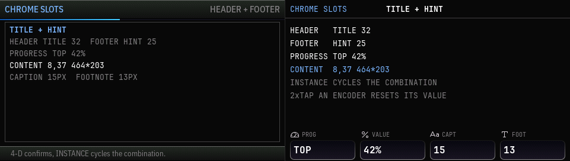
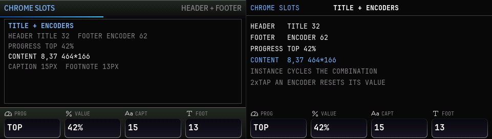
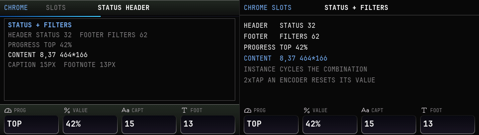
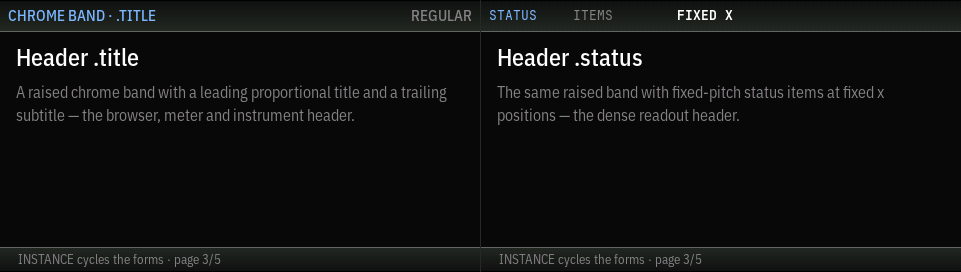
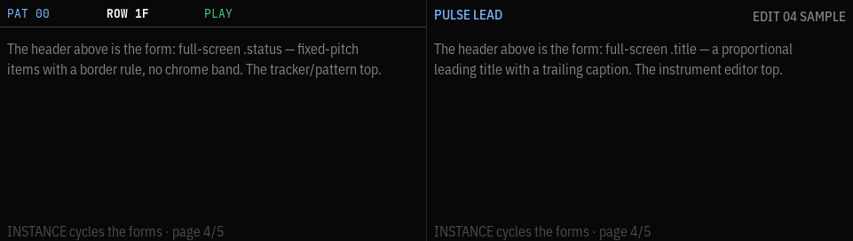
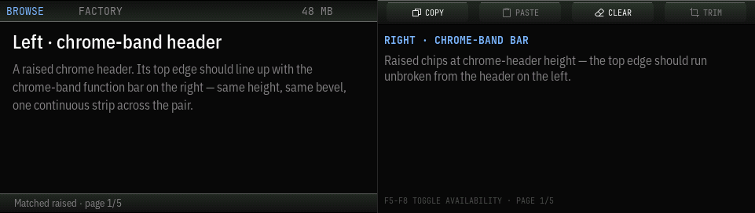
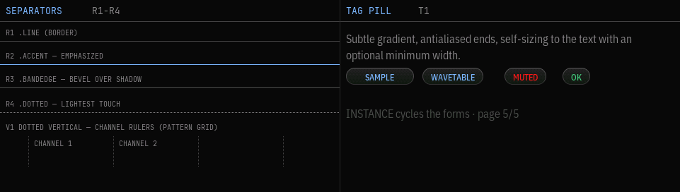

*Code:* `ScreenLayout.swift` (`MK2ScreenHeader`, `MK2ScreenFooter`, `MK2RegularScreenChrome`), `FunctionKeyBar.swift`, `Separator.swift` · *Demos:* `chrome-slots` (INSTANCE cycles the combinations), `forms`

## 8. Components

### 8.1 Value cells and encoders (`MK2ValueCell`, `MK2EncoderDiscreteValueElement`)

Debossed wells, bottom-flush in the encoder slots. The label names the
*parameter/unit/filter*, never the encoder. Focused/touched cells render
identically (`focused*` tokens). Encoder behavior: tiny domains never wrap
(`wrapMinimumValueCount`), throw scales to the domain
(`targetSweepCounts`), double-touch resets to `defaultValue` (never bound
to anything destructive). Raw 1:1 encoders are escape hatches that state
their reason at the call site.

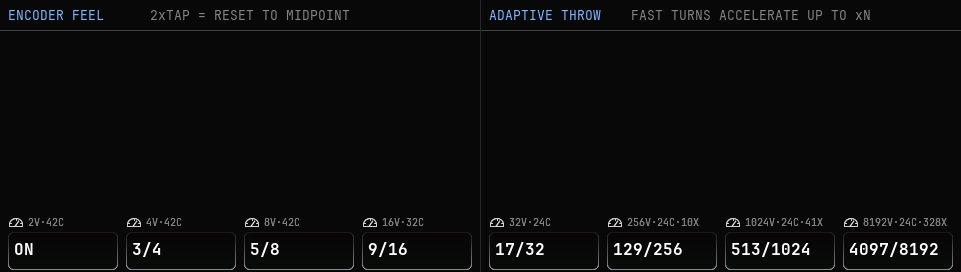

*Code:* `ValueCell.swift`, `EncoderDiscreteValue.swift`, `ParameterPage.swift`, `EncoderScaler.swift` · *Demo:* `encoder-feel`

### 8.2 Selection (`MK2SelectionList`, `MK2SelectionGrid`, columns, filters)

One selection treatment everywhere (§6). Lists move one row per 4-D
up/down, one page per left/right; grids move one cell horizontally, one row
vertically. Unavailable items dim but still highlight on selection. Filter
cells sit in fixed encoder slots (E-slot = `(encoder-1) % 4`) regardless of
display. Tabular lists align mixed mono/proportional columns on the
baseline.

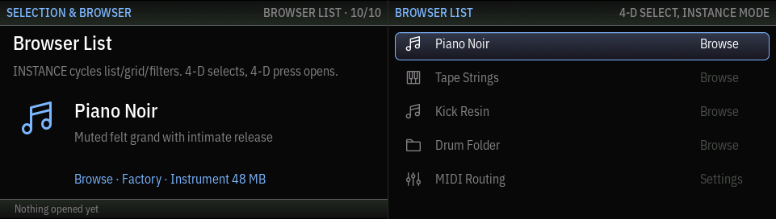
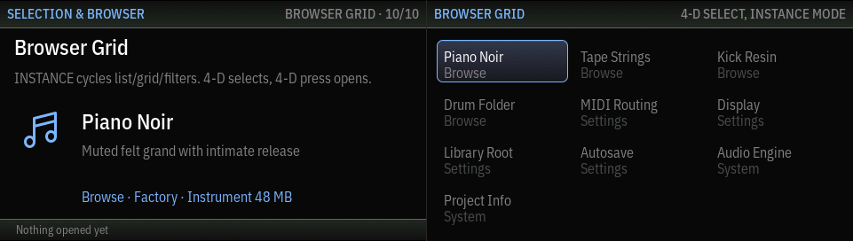
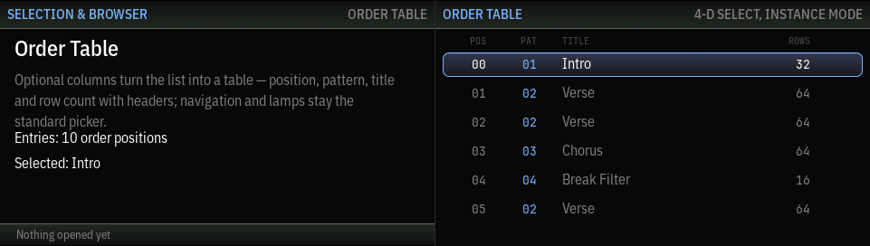
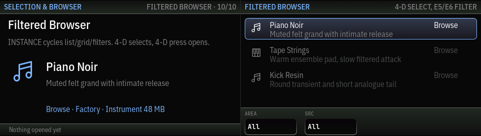

*Code:* `SelectionView.swift` (`MK2SelectionList`, `MK2SelectionGrid`, `MK2SelectionColumn`, `MK2SelectionFilter`), `SelectionFilterEncoder.swift` · *Demo:* `selection-browser` (INSTANCE cycles list/grid/table/filtered)

### 8.3 Dialogs (`MK2ModalDialog`, `MK2DialogCard`)

The modal dialog owns both displays and all bindings: 4-D moves selection,
4-D press confirms, **any other button cancels** — always stated in the
footnote. Severity (info/warning/error/question) drives ring, title and
icon tone; the selected action carries the selection highlight in the
severity tone. Secondary destructive actions stay visually recessive.
`MK2DialogCard` is the inline single-screen sibling (no bindings taken).

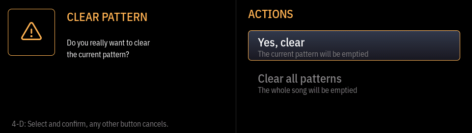
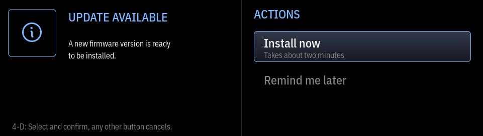

*Code:* `ModalDialog.swift`, `DialogCard.swift` · *Demo:* `modal-dialog` (INSTANCE cycles the severities)

### 8.4 Popups and layers

Semantics decide the form, never available screen space
(`Docs/Held-Command-Bar.md`):

- **Command popup** (`MK2HoldCommandBarElement`): held F-key plane; a press
  executes one immediate command. Base scene dims to half brightness.
- **Setting popup** (`MK2HoldActionOverlayElement`): held F1–F8 selection
  whose value persists after release.
- **Passive popup** (`MK2PopupOverlayElement`): prompt/capture card over a
  50%-dimmed scene; lamps and bindings of the scene stay alive.
- **SHIFT layer**: scene-declared (`MK2ShiftBranch`, `shiftSlots`), reveals
  rarer alternates of the base action in the same physical slot, labels in
  `shiftAccent`, momentary, never latching.

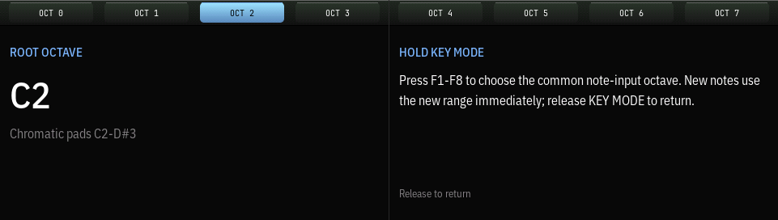
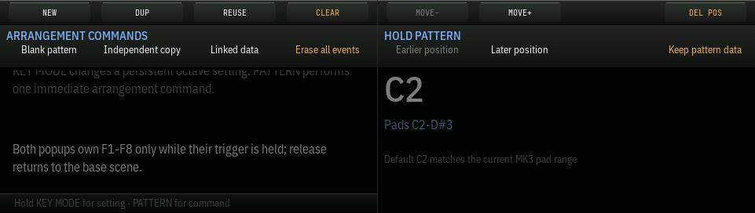
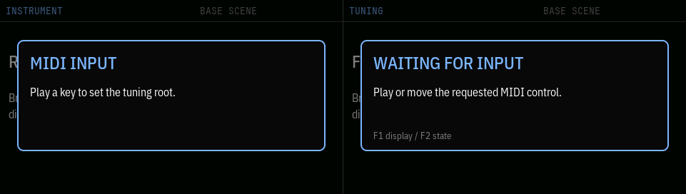
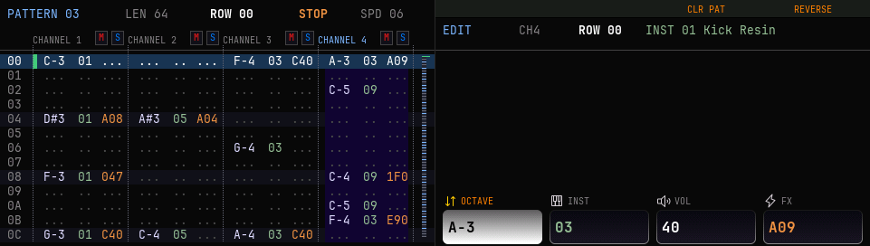

*Code:* `HoldActionOverlay.swift`, `PopupOverlay.swift`, the shift layer in `ScreenDSL.swift` (`MK2ShiftBranch`) · *Demos:* `hold-action-overlay`, `popup-overlay`, `tracker-pattern` (hold SHIFT)

### 8.5 Meters (`MK2MeterElement`)

Five fill styles — solid, gradient, segmented, segmented-gradient,
ProTracker — over a shared debossed track (`strokeInset`) with a 1px peak
line. The ProTracker tube shading is part of the identity and stays; Aurora
recolors, if any, arrive as an *additional* style, never a replacement.
Green/yellow/red zone semantics follow §3.3; amber/red are never used for
anything but level.

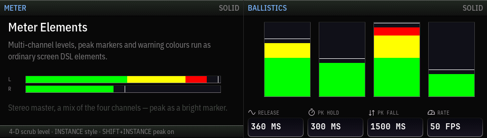
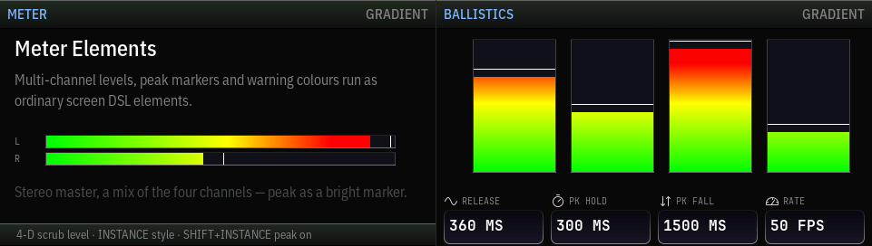
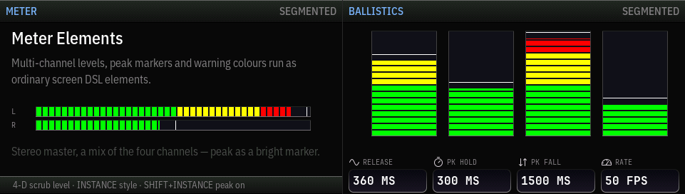
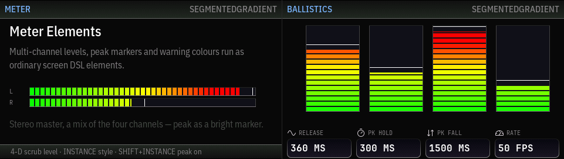


*Code:* `Meter.swift` (`MK2MeterElement`), `MeterBallistics.swift` · *Demo:* `meter` (INSTANCE cycles the styles)

### 8.6 Waveform (`MK2WaveformDisplayElement`)

Black canvas, blue trace, green start/end beacons, white playhead —
identical to the Paulinche app (§3.3). Region shading at 12% trace over
black; markers are structural (mint/green), the loop region is state.

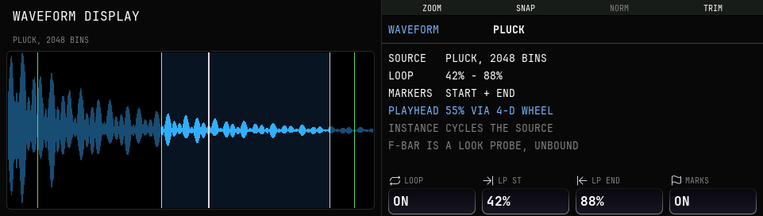

*Code:* `WaveformDisplay.swift` · *Demo:* `waveform`

### 8.7 Tracker pattern (`MK2PatternGridElement`, `MK2OverviewScrollbarElement`)

Fixed-pitch grid, per-field coloring (note/instrument/effect), configurable
beat stripe (`.every(interval, phase:)`) so odd meters stripe on the beat.
The minimap scrollbar shares the hardware-approved palette. E1–E4 touch
selects the channel, rotation moves the cursor row.

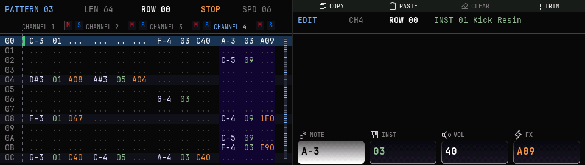

*Code:* `PatternGrid.swift`, `OverviewScrollbar.swift` · *Demo:* `tracker-pattern`

### 8.8 Cross-display artwork

Full-bleed imagery spanning both panels must skip the calibrated bezel gap
so lines continue optically across the physical seam.

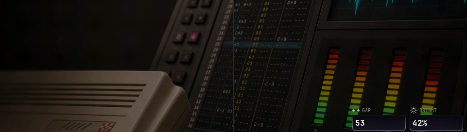

*Code:* `PixelImage.swift`, gap-aware composition in the demo · *Demo:* `panorama`

## 9. Interaction invariants (summary)

- Hardware labels sit directly above/below their physical control.
- Encoder touch selection is runtime-owned (`MK2EncoderSelectionBehavior`);
  apps never rebuild the touch→state→focus round trip.
- SHIFT is the only first-class modifier, scene-owned, momentary.
- Value cells: no `E<n>` prefixes; icons carry semantics in their own tint.
- Modal dialogs: any unbound button cancels.
- Pixel display diffs preserve deterministic rendering and stable geometry.

## 10. Adoption status

| Aurora element | Status |
| --- | --- |
| Selection highlight (ring + gradient + light edge) | **adopted 2026-07-23** (`aurora-graphite` branch), bench-pending |
| Debossed wells deepened | **adopted 2026-07-23**, bench-pending |
| Meter inset track + 1px peak | **adopted 2026-07-23**, bench-pending |
| Semantic palette tokens | tokens present, not wired into `Chrome` |
| `Chrome.accent` centralization (six literal copies) | **adopted 2026-07-23** — theme tokens only work when there is exactly one |
| Chrome-mirror literal sweep (background/text/dim/border/footerFill/headerFill, `Selection.fill` token) | **adopted 2026-07-23**, pixel-neutral over all 75 renders. Deliberately not centralized: the approved tracker palette (`PatternGrid`, note/instrument/effect, stripe/fills), decorative oranges, and the daemon's NO CLIENT drawing (below the Kit2 layer) — value coincidence is not role identity |
| `Chrome.accent` → `Palette.navigation` recolor | **rejected 2026-07-23** — indistinguishable on the OLEDs (side-by-side and flip-flop); identity stays 0x7dbf |
| Amber conflict (`warn` vs `shiftAccent`) | **resolved 2026-07-23** — four ambers collapsed to two: `warn` (warnings + destructive) and `shiftAccent` (shift layer), bench-verified distinguishable |
| Waveform Aurora ramp | rejected until app+hardware change jointly |
| Full-screen washes / vignettes / soft glows | rejected permanently (§1, §6) |
| Object-identity colors (NI-inspired, 2026-07-23) | **proposed** — a second, orthogonal color axis: user/group/instrument colors carried by *content* (pattern channels, arranger rows, tiles, selection tint in content contexts), as on the MASCHINE MK3 factory UI. Does not touch the semantic accents; lives inside the 15% structuring share of the 80/15/5 rule. Needs a Paulinche-side data model (per-instrument color) first |
| Chrome diet, footer (NI-inspired) | **adopted 2026-07-23** — well 38→33, footer derives 62→57, filter cells unified onto the slot height; +5 content rows per screen with the deboss intact. Prerequisite was figure-band value centering, so the slimmer well stays optically centered |
| Debossed header band | **adopted 2026-07-23** — header light curve inverted (footer stays raised), both lit edges frame the content plane. Symmetric inversion of both bands was tried and rejected on the bench |
| Chrome diet, header | **adopted 2026-07-23** — band 32→28 on the debossed form; prerequisite was metric cap-band centering of the header text (the static formula ignored band height and rode +1.5px low at 28, bench-caught). Total chrome diet: +9px content per screen |

Bench rounds happen per `hardware-feel` practice: one variable at a time,
constants annotated with what was tried and why the current value won.
