# The Komplete Kontrol Protocol: A Technician's Guide

*By someone who spent too many hours with a logic analyzer and a hex editor, for someone who's about to do the same.*

---

## What this is

This is the protocol reference I wish I'd had when I started talking to Native Instruments Komplete Kontrol keyboards without the official software. It covers three generations — MK1 (2014), MK2 (2018), and MK3 (2023) — with a strong focus on MK2, because MK2 is where the protocol is richest and most accessible. MK1 is simple enough to summarize. MK3 is a different story that involves embedded Linux, Qt, and a protocol that doesn't carry pixels at all.

Everything here is reverse-engineered. Nothing comes from official NI documentation, because there is no official documentation. The findings come from USB captures, firmware image analysis, community projects (qKontrol, cabl, Rebellion, KompleteSynthesia), and staring at hex dumps until the bytes started talking back.

---

## Why (or: the part where I justify the hex dumps)

Fair question. Native Instruments ships perfectly good software for these keyboards, every serious DAW has an integration, and none of it requires a logic analyzer. Why drive the hardware raw?

Because the destination is **Paulinche**, a macOS tracker for Amiga MOD files — and a tracker is precisely the kind of application NI's stack cannot serve.

NI's software is built around exactly one workflow: their plugin ecosystem. The Komplete Kontrol application puts NKS instruments, preset browsing, and parameter pages on the displays; the DAW integrations put mixer strips and transport state there. Both are closed. There is no API to draw your own screen content, no way to define custom display pages, no hook to repurpose the light guide. If your application is not a DAW hosting NI plugins, the software has nothing for you — plugged into anything else, an S-Series is an expensive generic MIDI keyboard with dark displays.

And a tracker wants roughly the opposite of a mixer surface:

- **The pattern grid on the displays** — rows, notes, effect commands, scrolling in real time. That is arbitrary pixels at interactive rates, which is exactly what the MK2's host-owned framebuffer provides and what no semantic protocol (MCU, HUI, the MK3's widget vocabulary) can express.
- **Per-channel state at a glance** — four Amiga channels with mute/solo, VU meters, sample names. Meters redraw as narrow row bands; the partial blit was practically designed for this.
- **The light guide as tracker feedback** — scale tints, currently-sounding notes, sample key ranges.
- **Encoders and the 4-D wheel as tracker navigation** — row stepping on detents, pattern/order browsing, value entry with acceleration matched to a 10-bit encoder.

None of that is reachable through NI's software or a DAW protocol adapter. All of it is straightforward over the MK2's raw protocol: two 480×272 framebuffers, a palette light guide, and a bit-packed input report. Hence this guide. The protocol knowledge below is the foundation; CompleteControl (a privileged USB daemon plus Swift middleware) is the machinery; Paulinche is the reason.

---

## The three generations at a glance

The axis that matters most: **who owns the pixels**.

| Generation | Display | Protocol | Pixels owned by | Custom UI? |
| --- | --- | --- | --- | --- |
| **MK1** (S25/49/61/88, 2014) | 9× 16-segment LCD | HID report `0xe0`, glyph masks | — (segments) | text only |
| **MK2** (S49/61/88, 2018) | 2× 480×272 colour | raw RGB565 framebuffer blit (`0x84`, USB bulk) | **the host** | **yes — free pixels** |
| **MK3** (S49/61/88, 2023) | 1× 1280×480 colour | semantic msgpack-RPC, on-device Qt/QML | **the device** | only via asset uploads or device hack |

The counterintuitive takeaway: for *arbitrary* on-surface graphics, the **MK2 is the easiest of all three**, not the MK3. The MK3's "intelligence" is exactly what takes pixel ownership away from you.

<!-- PHOTO: All three generations side by side (MK1 S25, MK2 S61, MK3 S49) — ideally a top-down shot showing the display area of each -->

---

## Part I: MK1 — The Simple Years

### USB identity

```
VID: 0x17cc    PID: 0x1340 (S25 MK1)
Interface 2:  Interrupt IN 0x84, Interrupt OUT 0x02
USB-MIDI:     separate streaming interface, bulk IN
```

The MK1 is a straightforward USB peripheral. No SoC, no Linux, no rendering app. You claim interface 2, you send reports, you receive reports. That's it.

### Report map

| Report ID | Direction | Purpose | Size |
| --- | --- | --- | --- |
| `0x01` | IN | Surface input: buttons, encoders, touch strips | ~64 bytes |
| `0x80` | OUT | Button LEDs (brightness) | 25 bytes |
| `0x82` | OUT | Light guide (25 RGB triples) | 75 bytes |
| `0xA0` | OUT | Init / mode handshake | 2 bytes |
| `0xE0` | OUT | Display row (one row across all 9 displays; 3 reports per frame) | 248 bytes |

### Light guide

<!-- PHOTO: MK1 light guide lit up with a rainbow pattern — the raw RGB triples in action -->

25 keys with per-key RGB LEDs. Report `0x82` is dead simple: 75 bytes, three bytes per key (R, G, B), values `0x00`–`0xff`. Key 0 is the leftmost key (C). Base MIDI note is 48, so `keyIndex = midiNote - 48`.

```
82  ff 00 00  00 ff 00  00 00 ff  ...   ← report ID, then 25 × RGB triples
```

That's a rainbow. The firmware accepts this directly — no palette, no encoding, just raw RGB. The MK2 would complicate this considerably.

### Button LEDs

Report `0x80`, 25 bytes. Each byte is a brightness value `0x00`–`0x7f` for one button LED. Single-channel, no colour. The button-to-index mapping was reverse-engineered by the cabl project.

### Displays

<!-- PHOTO: MK1 16-segment displays showing text — maybe a parameter page or the default NI screen -->

Nine 16-segment LCD modules, each with 3 rows. Row 0 is a progress/bar segment only. Rows 1–2 are text or raw 16-segment glyph masks, 8 characters per row. One display report `0xE0` carries **one row across all nine displays**: an 8-byte header `00 00 <row> 00 48 00 01 00` followed by 240 bytes of row data — 16 bytes per display (8 characters × 2 bytes per glyph, low byte first), displays packed left to right. A full frame is three reports, one per row.

The font is CP437-compatible, derived from cabl's `FONT_16-seg.h` (MIT licensed, 129 entries). Each character is a 16-bit mask where each bit corresponds to one of the 16 segments. An "A" is `0x18cf`. A "B" is `0x523f`. You want to know which bit is which segment? Look at the cabl source.

### Init handshake

```
A0  00 00    ← report 0xA0, payload [0x00, 0x00]
```

Two zero bytes. The keyboard wakes up and accepts surface reports. No mode negotiation — the MK1 is always in host-control mode. The complexity arrives with the MK2.

### MK1 verdict

A perfectly good HID peripheral. Text on segment displays, coloured keys, brightness-controlled button LEDs. What it *can't* do is pixels — and that's what makes the MK2 the interesting generation.

---

## Part II: MK2 — The Good Hardware

The S-Series MK2 (S49/S61/S88, 2018) is where NI built something a technician can really enjoy. Two 480×272 colour displays, per-key RGB light guide, 49–88 keys, eight touch-sensitive endless rotary encoders, a 4-D jog wheel, a capacitive touch strip, transport controls, and a mode system that gives you two completely different ways to talk to the same hardware.

### USB topology

<!-- PHOTO: MK2 S61 from above, showing both 480×272 displays lit with custom content, light guide active, button LEDs on -->

The MK2 presents **four distinct USB interfaces**:

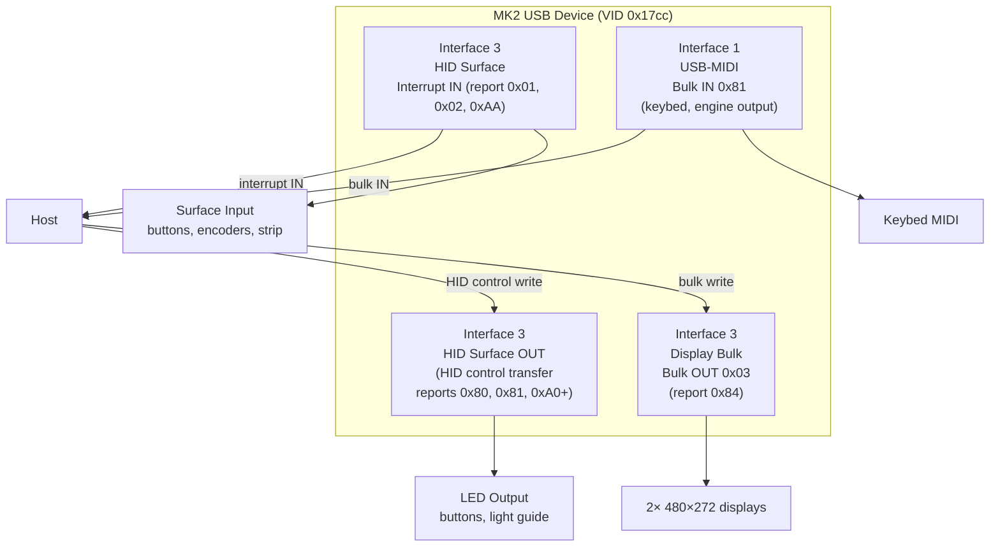

Device descriptor table:

| Model | PID | Keys | LG note offset | Claim IF | Display IF | Display EP |
| --- | --- | --- | --- | --- | --- | --- |
| S49 MK2 | `0x1610` | 49 | -36 | 3 | 3 | `0x03` |
| S61 MK2 | `0x1620` | 61 | -36 | 3 | 3 | `0x03` |
| S88 MK2 | `0x1630` | 88 | -21 | 3 | 3 | `0x03` |

The "light guide note offset" maps MIDI notes to key indices: `keyIndex = midiNote + offset`. For S49/S61, offset is -36 (MIDI note 36 = key 0). For S88, it's -21.

**macOS claiming caveat**: NI's background services claim these interfaces before third-party software can. qKontrol says "stop NI services first." Rebellion talks to NI's services instead. The CompleteControl solution is a privileged libusb daemon that claims interfaces at boot and holds them.

### The mode toggle: 0xA0

<!-- PHOTO: MK2 in host-control mode vs mapping-engine mode — side by side showing different LED states and display content -->

The first thing you send to an MK2. Report `0xA0` takes two payload bytes:

| Payload | Mode | What it does |
| --- | --- | --- |
| `00 10` | **Host-control** | All LEDs host-driven via `0x80`. Strip streams raw on report `0x02`. Keys/wheels stay USB-MIDI. |
| `93 00` | **Mapping engine** | Firmware owns function/ribbon LEDs, generates MIDI from templates `0xA1`–`0xA4`. Standalone-controller mode. |
| `00 00` | **Neither** | Strip and templates silent. The original "dead ribbon" bug. |

Host-control mode is what you want for a custom driver, and entering it is the entire handshake:

```
A0  00 10           ← enter host-control mode — that's it
```

In host-control mode the mapping engine is off, so the `0xA1`–`0xA4` templates are dormant — you don't need to write or suppress them at bring-up. They matter in two places only: configuring the engine when you *do* run `93 00`, and the shutdown handover (below), where you re-arm the engine with factory templates so the keyboard works standalone.

### The mapping engine: templates 0xA1–0xA4

When the mapping engine is active (`A0 93 00`), the firmware generates MIDI from templates you upload:

| Report | Configures | Payload size |
| --- | --- | --- |
| `0xA1` | Buttons + knobs (8 buttons ×12 + 8 knobs ×12 + 8 backlight + 3 trailer) | 203 bytes |
| `0xA2` | Wheels + touch strip (3 slots ×12 + 8 trailer) | 44 bytes |
| `0xA3` | Pedals | TBD |
| `0xA4` | Key zones | **never write blind** |
| `0xAF` | Commit | 2 bytes: `00 02` |

**The 0xA2 wheel/strip template** carries three 12-byte assignment slots — pitch wheel, mod wheel, touch strip — plus an 8-byte trailer. Each slot is one of three types:

**Off**: `00 00 00 00 00 00 00 00 00 00 00 00`

**CC (unipolar)** — value holds on lift, LEDs fill from left:
```
03  <cc>  <ch>  20  <min>  00  <max>  00  00  00  00  00
```

**Pitch bend (bipolar, 14-bit)** — springs to center, LEDs fan from center:
```
06  00  <ch>  00  00  00  ff  3f  00  00  01  00
```

The trailer describes the *strip's* behaviour when its slot is bipolar: byte 0 = pitch-bend decay (0–8, smaller = slower), byte 3 = strip LED zero point (`0x00` = left origin for unipolar, `0x02` = center origin for bipolar). For a unipolar (CC) strip, leave the trailer all zeros.

Complete `0xA2` for defaults (pitch bend, CC1 mod, CC11 strip):

```
A2  06 00 00 00 00 00 ff 3f 00 00 01 00    ← pitch wheel
    03 01 00 20 00 00 7f 00 00 00 00 00    ← mod wheel (CC1)
    03 0b 00 20 00 00 7f 00 00 00 00 00    ← strip (CC11)
    00 00 00 00 00 00 00 00                ← trailer
```

Then commit: `AF  00 02`

**The 0xA1 template** is 203 bytes. If you run the mapping engine, send all-zeros to suppress the factory knob CCs (14–21) that activate the moment the engine comes on; in host-control mode the engine is off and the template is dormant. On shutdown, write back the factory template so the keyboard works standalone:

```
knob 0 at offset 96:  03 0e 00 3c 00 00 7f 00 00 00 00 00    ← CC14
knob 1 at offset 108: 03 0f 00 3c 00 00 7f 00 00 00 00 00    ← CC15
...through knob 7 at offset 180: CC21
```

**The 0xA4 warning**: A malformed key-zone map silences the keybed and darkens the light guide until power cycle. If you must experiment, use a keyboard you can reach the power switch on. (I learned this the hard way. The keyboard sat dark for an embarrassing amount of time before I walked over and pulled the USB cable.)

### Input reports

The MK2 streams two input reports:

#### Report 0x01 — Surface input (buttons, encoders, jog wheel)

The main surface input report. Arrives unconditionally. Layout, fully bench-verified:

| Bytes | Content |
| --- | --- |
| 0 | Report ID (`0x01`) |
| 1 | Function buttons F5–F8 (bits 0–3), F1–F4 (bits 4–7) |
| 2 | Auto, Quantize, Arp, Scale (bits 0–3), Play, Loop, Undo/Redo, Shift (bits 4–7) |
| 3 | Stop, Record, Tempo, Metro (bits 0–3), Preset Up, Page Right, Preset Down, Page Left (bits 4–7) |
| 4 | Mute, Solo, Scene, Pattern (bits 0–3), Track, Clear, Key Mode (bits 4–6) |
| 5 | Mixer, Plugin, Browser, Setup (bits 0–3), Instance, MIDI (bits 4–5) |
| 6 | Jog wheel: `0x04`=cap touched, `0x08`=click, `0x10`/`0x20`/`0x40`/`0x80`=push L/U/D/R (OR'd with touch) |
| 7 | Encoder touch states (bit 7 = encoder 1, bit 0 = encoder 8) |
| 8 | Octave Down, Octave Up, Fixed Vel (bits 0–2) |
| 10–25 | 8 endless rotary encoders, 16-bit LE each (counter 0–999, modulo 1000) |
| 26–29 | Pitch/mod wheel fields (declared but never populated — wheels are MIDI-only) |
| 30 | Jog scroll value (low nibble, modulo 16) |

40 buttons across bytes 1–8. Every button has a matching LED index in the `0x80` output report — names must match exactly between input and output or bindings silently break. (This was a real bug: four button names had drifted between the input decoder and the LED enum. The buttons just did nothing. No error, no warning. Two days with a logic analyzer to find a typo.)

Jog wheel states from byte 6:

| Byte 6 | Event |
| --- | --- |
| `0x0c` | Press (click) |
| `0x14` | Push left |
| `0x24` | Push up |
| `0x44` | Push down |
| `0x84` | Push right |
| `0x04` | Cap touched (no directional push) |

Push events arrive OR'd with the touch bit (`0x04`) — the table values above already include it: push-up is `0x20 | 0x04 = 0x24`.

The eight rotary encoders are **high-resolution**: 10-bit values (0–999), many counts per small physical turn. Naïve `value += delta` is far too fast. You need range-relative stepping with acceleration based on inter-report interval. The encoders also have capacitive touch — byte 7 encodes which are being touched.

#### Report 0x02 — Raw touch strip (host-control mode only)

In host-control mode, the touch strip streams raw position at ~100 Hz:

| Bytes | Content |
| --- | --- |
| 0 | Report ID (`0x02`) |
| 1–2 | Constant (u16 LE) |
| 3–4 | Constant (u16 LE) |
| 5–6 | Time in milliseconds (u16 LE) |
| 7–8 | Position 0–1024 (u16 LE); 0 = finger released |
| 9–10 | Zero (u16 LE) |

Touch at position 512 (center) at time 1234 ms:

```
02  xx xx  xx xx  d2 04  00 02  00 00
              ↑ time=1234  ↑ pos=512
```

Release:

```
02  xx xx  xx xx  d6 04  00 00  00 00
                          ↑ pos=0
```

In mapping-engine mode, this report is silent — the strip generates MIDI via the `0xA2` template.

#### Report 0xAA — Controller mirror

When the mapping engine is active, a 51-byte report `0xAA` mirrors the engine's MIDI output in HID form. Knob values at offset `17 + 2*i` (16-bit LE), pitch wheel at bytes 33–34, strip CC at byte 37. Useful for debugging without parsing USB-MIDI. Not generated in host-control mode.

### Output: Button LEDs (report 0x80)

80 bytes total (report ID + 79 payload). Each byte controls one LED. Index map, bench-verified in host-control mode:

| Index range | LEDs |
| --- | --- |
| 0–1 | Mute, Solo |
| 2–9 | Function buttons F1–F8 |
| 10–14 | Jog Left, Jog Up, Jog Down, Jog Right, Shift |
| 15–41 | Scale, Arp, Scene, Undo/Redo, Quantize, Auto, Pattern, Preset Up, Track, Loop, Metro, Tempo, Preset Down, Key Mode, Play, Record, Stop, Page Left, Page Right, Clear, Browser, Plugin, Mixer, Instance, MIDI, Setup, Fixed Vel |
| 42–43 | Octave Down, Octave Up (never lit from host writes — most likely firmware-internal octave-transposition indicators) |
| 44–68 | Touch strip LEDs (25 segments) |

**Critical hardware constraint**: not all button LEDs are created equal.

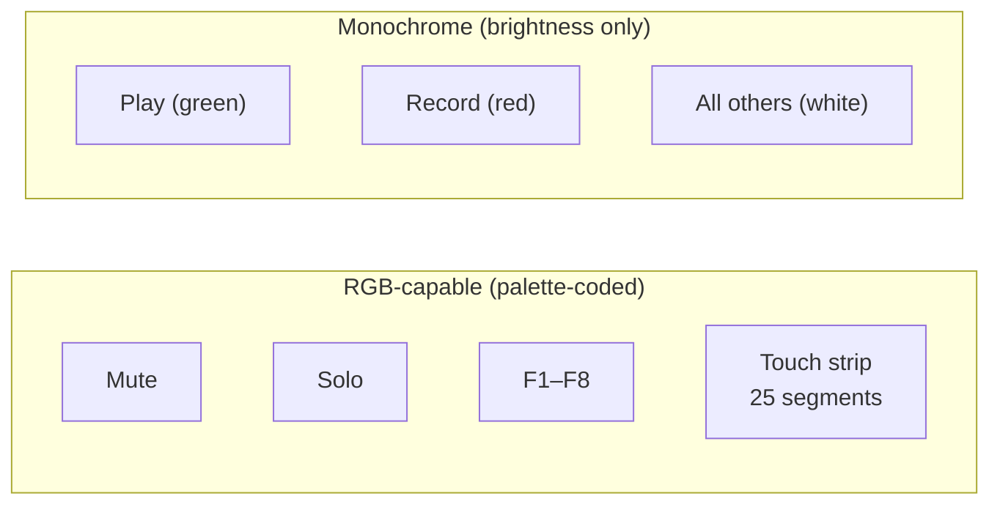

**Mute, Solo, F1–F8, and the 25 touch-strip LED slots** are palette-capable. The remaining panel button indicators are fixed-colour monochrome: Play is green, Record is red, everything else is white. You can't make Record blue. You can only set brightness (off, dim, medium, bright).

The LED byte encoding uses the palette system (see below). For palette-capable LEDs, the byte encodes palette index + intensity. For monochrome buttons, it encodes the fixed colour's palette entry at one of three brightness levels.

### Output: Light guide (report 0x81)

250 bytes total (report ID + 249 payload). Each byte controls one key's LED. Meaningful byte count depends on model: 49/61/88.

Unlike MK1's raw RGB triples, the MK2 uses a **palette-based encoding**. Each byte:

```
bits 7–2: palette index (1–17, 0 = off)
bits 1–0: intensity (0=25%, 1=50%, 2=75%, 3=100%)
```

The 17-colour palette:

| Index | Colour | Index | Colour |
| --- | --- | --- | --- |
| 1 | Red `ff0000` | 10 | Azure `007fff` |
| 2 | Orange-red `ff3f00` | 11 | Blue `0000ff` |
| 3 | Orange `ff7f00` | 12 | Indigo `3f00ff` |
| 4 | Amber `ffcf00` | 13 | Violet `7f00ff` |
| 5 | Yellow `ffff00` | 14 | Magenta `ff00ff` |
| 6 | Chartreuse `7fff00` | 15 | Pink `ff007f` |
| 7 | Green `00ff00` | 16 | Rose `ff003f` |
| 8 | Spring green `00ff7f` | 17 | White `ffffff` |
| 9 | Cyan `00ffff` | | |

Key 0 bright red: `paletteCode = (1 << 2) | 3 = 0x07`. Dim red: `(1 << 2) | 0 = 0x04`. Off: `0x00`.

Rainbow across first 17 keys:

```
81  07 0b 0f 13 17 1b 1f 23 27 2b 2f 33 37 3b 3f 43 47 00 00 ...
    ↑ key 0: red, full    ...                          ↑ key 16: white, full
```

The palette is fixed in firmware. If you need a colour not in it, pick nearest by Euclidean distance in RGB space.

### Output: Display (report 0x84, USB bulk)

<!-- PHOTO: MK2 displays showing custom-rendered content — ideally a tracker-style grid or waveform, something that clearly isn't from NI's software -->

The fun part. Two 480×272 RGB565 displays, arbitrary pixels. Transport is USB bulk on interface 3, endpoint `0x03` — not HID.

**The 0x84 blit command structure:**

```
Offset  Bytes  Content
0       2      Header: 84 00
2       1      Screen (0 = left, 1 = right)
3       5      Constant: 60 00 00 00 00
8       2      X position (u16 BE)
10      2      Y position (u16 BE)
12      2      Width (u16 BE)
14      2      Height (u16 BE)
16      6      Constant: 02 00 00 00 00 00
22      2      Pixel count / 2 (u16 BE)
24      ...    RGB565 pixel data (big-endian halfwords)
...     12     Trailer: 02 00 00 00 03 00 00 00 40 00 00 00
```

Yes, the pixel data is **big-endian** RGB565. The rest of the protocol is little-endian where applicable, but pixels are BE. Don't ask. Maybe the display controller is from a different design team. Maybe it's an inside joke. Either way, byte-swap on a little-endian host.

Full-screen blit to screen 0, all white (RGB565 `0xffff`):

```
84 00  00  60 00 00 00 00  00 00  00 00  01 e0  01 10
  02 00 00 00 00 00  ff 00  [130,560 pixels = 261,120 bytes of ff ff...]
  02 00 00 00 03 00 00 00 40 00 00 00
```

Header breakdown:
- `84 00` — command
- `00` — screen 0 (left)
- `60 00 00 00 00` — constant
- `00 00` — X = 0
- `00 00` — Y = 0
- `01 e0` — width = 480
- `01 10` — height = 272
- `02 00 00 00 00 00` — constant
- `ff 00` — pixel count / 2 = 65,280 (u16 BE; this field caps a single blit at 131,070 pixels — one full screen fits with room to spare)
- ... pixel data ...
- `02 00 00 00 03 00 00 00 40 00 00 00` — trailer

**Partial updates** are the key to performance. You can blit any (x, y, w, h) rectangle — a single row, a 40-pixel band, whatever (even pixel count required). A reconciler that diffs and sends only changed rows keeps USB traffic minimal.

### Framebuffer bandwidth budget

**Platzhalter: USB transfer trace in Wireshark/USBPcap showing a burst of 0x84 bulk transfers; the byte counts tell the partial-update story.**

RGB565 = 2 bytes/pixel. One screen = 255 KB. Both = 510 KB. USB 2.0 High Speed bulk: ~30–40 MB/s realistic.

| Update | Bytes | @30 MB/s | Ceiling |
| --- | --- | --- | --- |
| Both screens, full frame | 510 KB | ~17 ms | ~59 fps |
| One screen, full frame | 255 KB | ~8.5 ms | ~117 fps |
| One row band (480×40) | 37.5 KB | ~1.3 ms | hundreds fps |

Smooth 60 fps is attainable for realistic UIs. You almost never repaint a whole screen per frame.

Measured on S61 MK2 (debug build, TRACE log): ~0.4 ms fixed + ~0.06 ms per row. A 1-row update: ~0.5 ms. A 40-row band: ~3 ms. A full 272-row frame: ~17 ms.

### USB-MIDI

The keybed, pitch wheel, and mod wheel communicate through a standard USB-MIDI streaming interface (interface 1, bulk IN `0x81`), separate from the HID surface. They run in parallel. In host-control mode, the keybed produces normal MIDI note on/off, pitch bend, CC1. The touch strip does *not* produce MIDI in this mode — it streams raw on HID report `0x02`.

In mapping-engine mode, the strip and rotaries produce MIDI via the firmware template engine, and output also appears on USB-MIDI (mirrored in HID report `0xAA`).

### The complete MK2 bring-up sequence

<!-- PHOTO: MK2 coming alive — a sequence shot or animated GIF of the keyboard lighting up as the init sequence runs (LEDs cascade, displays flash on) -->

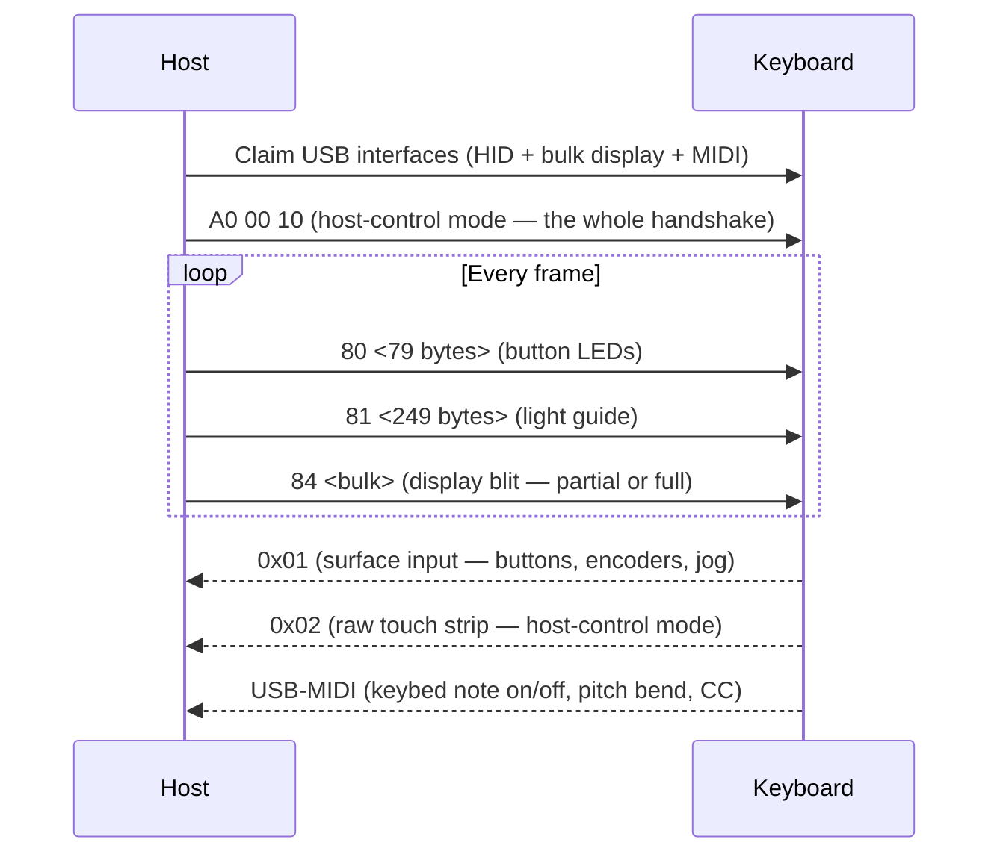

### The complete MK2 shutdown sequence

When you're done and want to leave the keyboard usable standalone:

```
A0  93 00                       ← re-enter mapping-engine mode
A1  <factory knob template>    ← restore CC14–21 rotary mapping
A2  <default wheel/strip map>  ← restore pitch bend / CC1 / CC11
AF  00 02                       ← commit
80  <79 zeros>                  ← clear button LEDs
81  <249 zeros>                 ← clear light guide
84  <black frames to both screens>
```

Note what is *not* in there: `A0 00 00`. That payload is not "exit host-control" — it's the third mode where the strip and templates go silent (the dead-ribbon state). The correct handover is to switch the engine back **on** (`93 00`) so the factory templates you just restored actually run.

Skip this and the keyboard stays dark and confusing for the next person who sits down. (Which might be you, tomorrow, wondering why your keyboard is broken.)

---

## Part III: MK3 — The Computer That Has a Keyboard

The MK3 (S49/S61/S88, 2023) is where NI decided the keyboard should be smart. Very smart. Linux-running, Qt-rendering, msgpack-RPC-speaking smart. And in doing so, they made it simultaneously more powerful and more locked down.

The MK3 is not a USB peripheral with a dumb panel. It is a small Linux computer.

### Hardware architecture

<!-- PHOTO: MK3 S49 from above — the full-width 1280×480 display showing NI's factory UI, light guide active -->

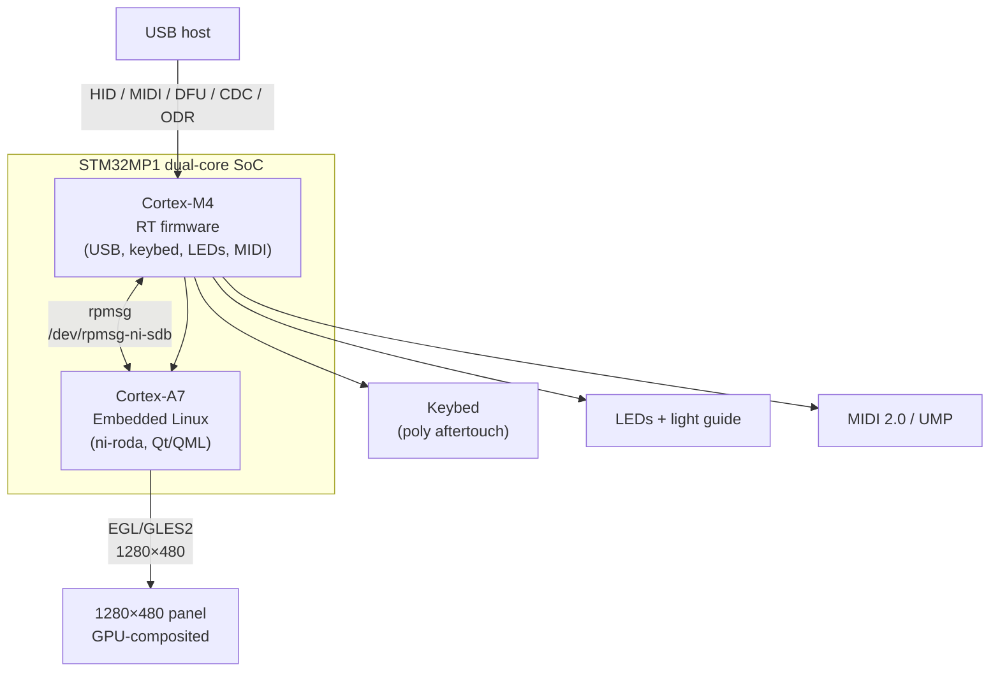

The SoC is an **STM32MP157A**: dual Cortex-A7 cores (running Linux) plus a Cortex-M4 coprocessor (realtime firmware). The M4 owns USB, the keybed, LEDs, and MIDI. The A7 runs `ni-roda` — the *NI Rendering On-Device App* — a 26 MB ARM Qt/QML application that renders the display and hosts a msgpack-RPC server.

The display is a single 1280×480 colour panel, GPU-composited from a QML scene graph. The host never sees pixels. The host never sends pixels. The host sends a **semantic model** — "parameter page with these values", "browser with these results", "light guide with these colours" — and the device renders it.

### USB interfaces

The M4 firmware exposes multiple independent USB interfaces:

| Interface | Purpose |
| --- | --- |
| HID | Legacy HID (light guide `0x82`, mode toggle `0xA0`, display `0x84` — MK2-compatible path) |
| MIDI | USB-MIDI (UMP / MIDI 2.0, with group terminal blocks for Main/DAW/ExtIn/ExtOut) |
| DFU | Device Firmware Upgrade |
| CDC | Serial/data (possibly the TCP/UDS shortcut) |
| **ODR** | **On-Device Rendering** — the dedicated bulk pipe for the rich display protocol |

The **ODR interface** is the key. It carries the msgpack-RPC protocol that drives the display. The M4 bridges it to the A7 over rpmsg (`/dev/rpmsg-ni-sdb`). The HID interface still works for backward compatibility (light guide, basic LED control), but the rich UI — browser, parameter pages, mixer, Smart Play — is all ODR.

MIDI and ODR are **separate interfaces**. They run in parallel. The old community finding that "LED control and MIDI are mutually exclusive" was an artifact of probing only the legacy HID interface — on the MK3, there's no mutex. NI's own software drives keys + display + light guide simultaneously every day.

### Product IDs

| Model | PID |
| --- | --- |
| S49 MK3 | `0x2100` |
| S61 MK3 | `0x2110` (expected) |
| S88 MK3 | `0x2120` |

### The ODR protocol: msgpack-RPC

The wire protocol is **MessagePack-RPC**, namespaced under `ni::odr::protocol::kks` (kks = Komplete Kontrol S-series). The entry point is a versioned handshake:

```
host → device:  kks::handshake
device → host:  kks::handshake_reply
```

After the handshake, the host drives the display by pushing **semantic models** — typed RPC messages that tell `ni-roda` what to render. The device renders them with Qt Quick and GPU-composites the result to the panel.

#### Host → device verbs (48 commands)

Recovered from `ni-roda`'s `register_handlers` dispatch table. Each handler's C++ parameter type is preserved in the mangled symbol names, and the registration index is very likely the on-wire method ID. Highlights:

| ID | Payload type | Meaning |
| --- | --- | --- |
| 1 | `handshake` | Session open → `handshake_reply` |
| 6 | `asset_id, bytes, bytes` | **Asset upload** — SHA-256-addressed image (webp/png/jpeg/tiff) |
| 7 | `asset_id` | Asset remove/evict |
| 18 | `variant<device_owned_lightguide, map<note, rgb>>` | **Light guide model** |
| 23 | `parameter_page_viewmodel_data<asset_id>` | **Parameter page model** |
| 28 | `parameter_id, variant<continuous, toggle, discrete, bipolar>` | **Single parameter update** |
| 29 | `browser_data<asset_id>` | Browser content |
| 32 | `sound_results<asset_id>` | Sound result list |
| 44 | `smartplay_engine_state` | Scale/arp engine |
| 20 | `vector<array<float,2>>` | **Mixer meters** — stereo L/R pairs |

Note the **host-owned vs device-owned viewstate** split: some state the host pushes, some the device owns (e.g. local cursor/scroll position), and they're reconciled on-device. This is directly analogous to a diff-and-send reconciler — the device does the final merge.

#### Device → host events (16 events)

Surface input flows back as typed events. The heart is event **#7**: a `std::variant` of ~56 tagged structs covering every surface input:

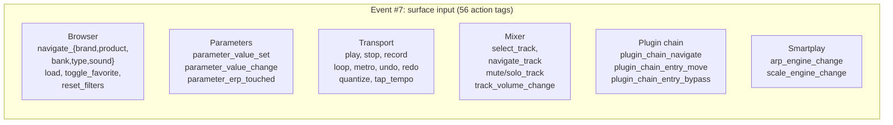

For a custom driver, these map almost 1:1 to typical surface input events: encoder turns, button presses, transport gestures, browse navigation. The input layer is actually cleaner than the MK2's raw HID reports — you get typed, semantic events instead of bit-packed byte arrays.

### Custom graphics: the asset path

**Platzhalter: MK3 displaying a custom-uploaded asset image on its screen; proof that the asset upload path works.**

There **is** a way to get bespoke imagery on the MK3 screen, just not via a framebuffer. You upload a compressed image (webp, png, jpeg, or tiff) as a **content-addressed asset** (SHA-256 hash as ID), then reference that asset ID from a model field. The device caches assets locally.

The realistic "free image on screen" path:

1. Encode your bitmap as webp/png
2. Compute its SHA-256
3. Send RPC command #6: `asset_id, image_bytes, metadata_bytes`
4. Reference the asset ID in a model field (e.g. `parameterModel.background = asset_id`)

This works, but it makes live graphics (a scrolling pattern grid, a real-time waveform) an **image-streaming problem** — encode + upload per frame — rather than a draw-call problem. Its practicality (frame rate, asset-cache churn, max bitmap size) is a bench unknown.

### The "custom firmware" option

<!-- PHOTO: MK3 serial console output on a logic analyzer screen or terminal — the U-Boot prompt with init=/bin/sh, proving the device is open -->

The ODR protocol confines you to NI's QML widget vocabulary. A pixel-exact tracker pattern grid is **not** expressible through it (only via per-frame asset uploads). The alternative is to stop talking *to* the device and instead **run your own code on the device**.

The A7 runs ordinary Linux with a full GPU stack. The firmware image reveals it is largely unlocked:

- Boot is plain extlinux (not a signed FIT image)
- Rootfs is a plain ext4 partition, mounted `rw`
- No dm-verity, no fs-verity, no module signing
- No rootfs integrity verification at all
- UART4 (TX = PG11, RX = PB2, 115200 8N1) is the debug console
- U-Boot is likely interruptible (bootdelay lives in a separate env partition)
- `init=/bin/sh` from the U-Boot prompt gives passwordless root

From there, you could install a systemd service that draws your own UI with `libdrm`/`libGLES2` (already in `/vendor/lib`), talk to the M4 for keybed/LEDs/MIDI over `/dev/rpmsg-ni-sdb`, and get **unlimited pixel control** — the tracker grid becomes a trivial draw.

Costs: it voids the warranty, risks a brick (mitigated by ROM DFU recovery if the device is "open"), forfeits NI's host-integration entirely, and every firmware update overwrites your changes. It's a fork of the device, not a remote-control client. Recommended only as a deliberate second track — and only after a serial-console recon confirms the device is open.

### MK3 verdict

The MK3 is the most capable keyboard of the three, but it's the hardest to use as a custom display surface. The protocol is semantic, not pixel-based. You get typed RPC calls instead of raw framebuffer access. For UI that maps onto NI's widget vocabulary (parameter pages, browsers, lists, meters), it's clean and high-fidelity. For anything outside that vocabulary, you're either streaming image assets or hacking the device's Linux.

The irony is thick: the MK3 has the best screen, the most processing power, and the most sophisticated protocol — and it's the one where you have the *least* control over what appears on that screen. The MK2, with its dumb framebuffer blit, gives you more pixel freedom than the MK3's embedded Linux ever will.

---

## Part IV: Side-by-side comparison

### Report ID map across generations

| Report ID | MK1 | MK2 | MK3 (legacy HID) | MK3 (ODR) |
| --- | --- | --- | --- | --- |
| `0x01` | Surface input | Surface input | — | — |
| `0x02` | — | Raw touch strip | — | — |
| `0x80` | Button LEDs (brightness) | Button LEDs (palette) | — | — |
| `0x81` | — | Light guide (palette) | — | — |
| `0x82` | Light guide (raw RGB) | — | Light guide (raw RGB) | — |
| `0x84` | — | Display blit (bulk) | Display blit (bulk) | — |
| `0xA0` | Init | Mode toggle | Mode toggle | — |
| `0xA1`–`0xA4` | — | Mapping templates | — | — |
| `0xAA` | — | Controller mirror | — | — |
| `0xAF` | — | Template commit | — | — |
| `0xE0` | Display (segments) | — | — | — |
| RPC #1 | — | — | — | Handshake |
| RPC #6 | — | — | — | Asset upload |
| RPC #18 | — | — | — | Light guide model |
| RPC #23 | — | — | — | Parameter page |
| Event #7 | — | — | — | Surface input (56 tags) |

### Display capabilities

| | MK1 | MK2 | MK3 |
| --- | --- | --- | --- |
| Resolution | 9× 16-segment | 2× 480×272 | 1× 1280×480 |
| Colour | monochrome | RGB565 (65K) | full colour (GPU) |
| Transport | HID `0xE0` | USB bulk `0x84` | msgpack-RPC (ODR) |
| Pixel control | none | **full framebuffer** | none (semantic only) |
| Custom graphics | text only | **arbitrary bitmaps** | asset uploads only |
| Partial updates | per-row | any rectangle | n/a (device renders) |

### LED capabilities

| | MK1 | MK2 | MK3 |
| --- | --- | --- | --- |
| Light guide | raw RGB (25 keys) | palette (17 colours × 4 intensities) | raw RGB via HID `0x82` or RPC #18 |
| Button LEDs | brightness only | palette for M/S/F1-F8, rest monochrome | RPC semantic model |
| Touch strip | brightness | palette (25 segments) | RPC semantic model |

### Input capabilities

| | MK1 | MK2 | MK3 |
| --- | --- | --- | --- |
| Surface input | HID `0x01` (bit-packed) | HID `0x01` (bit-packed, 40 buttons) | RPC event #7 (56 typed tags) |
| Encoders | in `0x01` | 10-bit (0–999), capacitive touch | typed events |
| Jog wheel | — | 4-direction + click + touch | typed events |
| Touch strip | in `0x01` | raw `0x02` (host-control) or MIDI (engine) | typed events |
| Keybed | USB-MIDI | USB-MIDI | USB-MIDI 2.0 (UMP) |
| Aftertouch | — | — | polyphonic |

### Architecture comparison

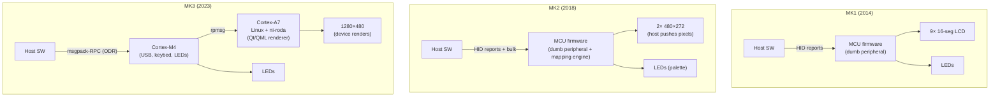

The progression is clear: from dumb peripheral (MK1) to dumb peripheral with a mapping engine (MK2) to a computer that renders its own UI from semantic commands (MK3). Each step adds intelligence and takes away direct control.

---

## Part V: Practical notes for the workbench

### Claiming interfaces on macOS

**Platzhalter: Terminal showing the daemon's TRACE log during interface claim, including the libusb_detach_kernel_driver / claim_interface sequence with status codes.**

On macOS, the HID interface is typically claimed by NI's `Komplete Kontrol.app` and its background helper. Three strategies:

1. **Stop NI services** (qKontrol approach): kill the helper, claim the interface, accept that NI software won't work while you're running.
2. **Talk to NI's services** (Rebellion approach): don't claim USB at all, use NI's IPC API instead. You're limited to what NI exposes.
3. **Privileged daemon** (CompleteControl approach): a root-level libusb daemon (`ccd`) claims the interfaces at boot via `libusb_detach_kernel_driver` + `libusb_claim_interface` and holds them. Client apps talk to the daemon over a Unix socket. The daemon is the single USB owner; clients never touch USB directly.

The daemon approach has a nice property: the USB session is persistent across client reconnects. If your app crashes, the keyboard stays initialized. The daemon can also run a simulator backend that produces byte-identical reports, so clients can't tell whether they're talking to real hardware or a simulation.

### libusb vs IOKit

The MK2 can be driven through two paths on macOS:

- **IOKit HID**: `IOHIDManagerCreate` + `IOHIDDeviceOpen` with `kIOHIDOptionsTypeSeizeDevice`. Works for HID reports (input `0x01`, output `0x80`/`0x81`/`0xA0`). Does **not** work for the display bulk endpoint `0x84` — IOKit HID doesn't expose bulk transfers.
- **libusb**: `libusb_open_device_with_vid_pid` + `libusb_claim_interface`. Works for both HID reports (via `libusb_interrupt_transfer`) and bulk display transfers (via `libusb_bulk_transfer`). Requires root or `com.apple.vm.device-access` entitlement.

The CompleteControl project uses libusb for everything, including HID reports, to keep a single USB session across all endpoint types. The `KontrolUSB.c` layer wraps libusb with a kqueue-integrated event loop: `libusb_get_pollfds` → kqueue `EVFILT_READ`/`EVFILT_WRITE` → `libusb_handle_events_timeout_completed`. This integrates USB I/O into a standard POSIX event loop without polling threads.

### Debugging tips

- **TRACE logging**: The daemon supports `KK_USB_DEBUG=1` or `LOGLEVEL=TRACE`. USB transfers are logged with endpoint addresses, report IDs, byte counts, and status codes. The log is timestamped and thread-safe (a background pthread with a mutex-protected ring buffer).
- **Hex dumps**: `kk_usb_debug_head()` prints the first 12 bytes of every transfer. Enough to identify report IDs and mode bytes without flooding the log.
- **The simulator**: The daemon has a simulator backend that produces byte-identical input reports and accepts output reports. You can develop and test your client without a keyboard connected. The simulator renders LEDs and displays from the same palette and blit protocol the real hardware uses.
- **Wireshark with USBPcap**: For capturing USB traffic when NI's software is running. Filter on `usb.device_address` and `usb.transfer_type == 0x03` for interrupt transfers (HID) or `0x02` for bulk (display).

### Simulation: how KompleteSimulator fell out of the reverse engineering work

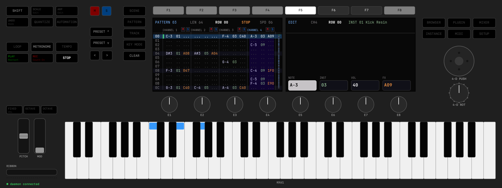

*The full simulator panel, captured through its headless snapshot mode (`KONTROLSIM_SNAPSHOT_PATH`) while a client feeds display blits and LED reports over the device socket.*

The simulator was not originally a cosmetic goal. It was a pressure release valve for the
reverse-engineering process.

Once the MK2 protocol stopped being a set of isolated hex facts and became a real surface
stack, the bottleneck moved from "can we light a pixel?" to "can we iterate on an entire
application workflow without touching the hardware every thirty seconds?" Paulinche and
`MK2WidgetLabDemo` needed to exercise pages, dialogs, focus rings, meters, button lamps,
encoder touches, keybed feedback, strip LEDs, and the NO CLIENT diagnostic mode. Doing all
of that only on the physical S61 MK2 made every UI iteration dependent on USB ownership,
daemon state, desk space, and whether the hardware was in front of the person writing the
code.

The obvious answer would have been a mock object inside the client. That would also have
been the wrong answer. The clients in this project deliberately do not own the low-level
device protocol. They connect to `ccd`, receive raw input reports, send display/LED
commands, and let the daemon arbitrate ownership. A client-local mock would prove only
that the client can talk to the mock. It would not prove that the daemon reactor, reconnect
logic, socket framing, raw report decoding, display blit path, or LED capability model were
still correct.

The important design decision was therefore this:

> The simulator must sit below the daemon, where the USB device normally sits, not above
> the daemon where a test double would sit.

That one decision shaped everything else. It means `MK2WidgetLabDemo`, Paulinche, and any
future surface client connect to the same daemon socket, send the same commands, receive
the same raw report bytes, and cannot tell whether the backend is libusb talking to real
hardware or a local AppKit process pretending to be a controller.

#### The seam we needed first

Before there could be a simulator, the daemon needed a replaceable device backend. The
original implementation was a libusb-shaped monolith: `DaemonHardware` owned a
`KontrolUSBLibUSBSessionRef` and called C entry points directly. That was fine while the
only possible device was a USB device. It was a dead end for simulation because all the
interesting code was mixed with "how do I write endpoint 0x02?" and "which poll fd did
libusb give me?"

The refactor introduced `KontrolDeviceSession`: a small class-bound protocol that captures
what the daemon actually needs from a device session:

- identity: product ID, generation, key count, lost/not lost
- output writes: HID reports and MK2 display blits
- input sources: async surface input and MIDI input sinks
- event-loop integration: poll fds and `handleEvents`
- lifecycle: close/stop

There are two implementations:

- `LibUSBDeviceSession` wraps the real libusb session and delegates to the C layer.
- `SimulatorDeviceSession` wraps a Unix-domain socket connected to the simulator app.

Everything above that seam is the same daemon. The same socket clients register. The same
push paths run. The same reconnect behavior is exercised. The same raw report decoders in
client code see the same bytes.

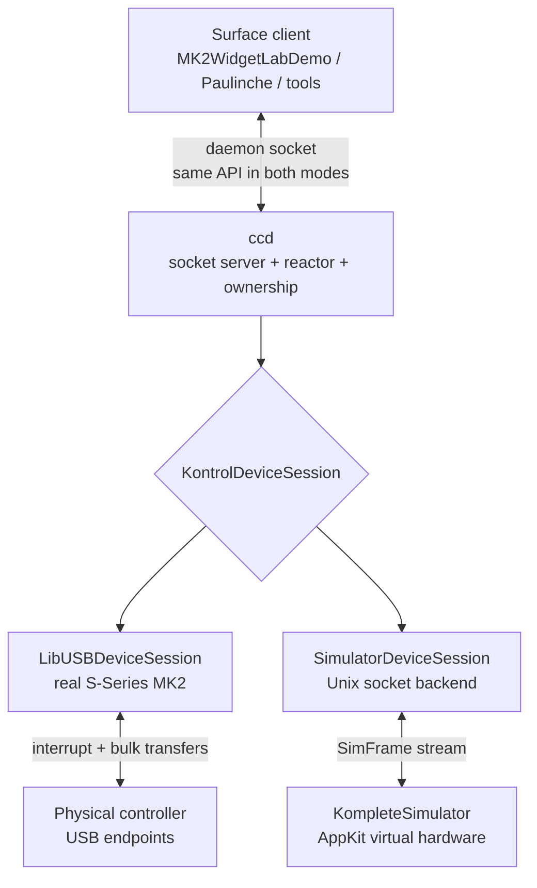

The environment switch is intentionally boring: `CCD_SIMULATE=<socket-path>` makes the
daemon open `SimulatorDeviceSession` instead of `LibUSBDeviceSession`. With no simulation
environment, it opens real hardware. This keeps "simulation" out of the client protocol.

#### Why the simulator emits semantic events, not raw reports

At first glance, the simulator app could have built full HID input reports itself. It has
the UI state, so why not let a button click directly create report `0x01`? We avoided
that for the same reason we avoided a client-side mock: duplicated protocol knowledge
rots quickly.

The reverse-engineered input report layout lives in `KompleteKontrolMK2.swift` and
`MK2InputReportBuilder`. The decoder and builder are intentionally mirror images. The
simulator app therefore emits semantic frames:

- button `X` pressed or released
- encoder `N` turned by `delta`
- encoder `N` touched or released
- 4-D encoder moved left/up/down/right, clicked, touched, centered, or rotated
- key note on/off and channel pressure
- pitch/mod/ribbon MIDI-like gestures

`SimulatorDeviceSession` lowers those semantic events into the same raw reports the
firmware would have sent. That keeps the GUI dumb in exactly the useful way. It knows
where a button is drawn and whether the mouse is down. It does not get to invent a second
copy of the MK2 input report format.

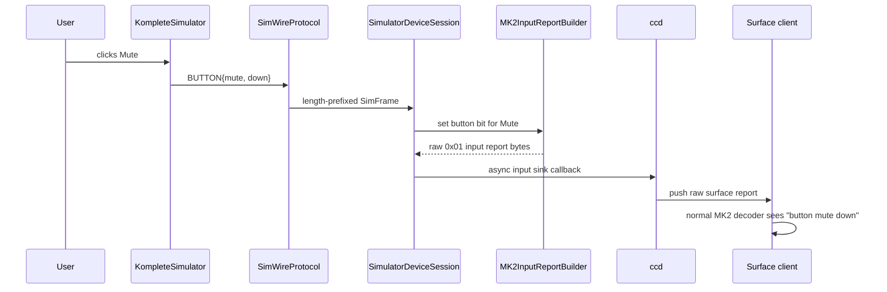

This is the transparency linchpin. A bug in the simulator's UI layout can make a virtual
button hard to click, but it cannot silently create a third protocol dialect. If the
builder output does not decode as the expected event, the round-trip tests fail.

#### The device-side wire protocol

The simulator wire protocol is deliberately small. It is not the MK2 protocol. It is a
private local protocol between the daemon backend and the virtual device process:

```text
[u8 frameType][u32be payloadLength][payload bytes]
```

The shared codec is `SimWireProtocol` (`SimFrame` and `SimWireCodec`). The frame types are
split by direction:

| Direction | Frame | Meaning |
| --- | --- | --- |
| simulator -> daemon | `HELLO` | product ID and key count advertised by the virtual device |
| simulator -> daemon | `BUTTON` | one MK2 button press/release |
| simulator -> daemon | `ENCODER` | one rotary delta |
| simulator -> daemon | `ENCODER_TOUCH` | explicit capacitive touch/release |
| simulator -> daemon | `FOURD_WHEEL` | 4-D encoder rotation delta |
| simulator -> daemon | `FOURD_STATE` | 4-D touch, center, click, or directional push |
| simulator -> daemon | `NOTE`, `MIDI`, `STRIP` | keybed, channel pressure, wheels, ribbon |
| daemon -> simulator | `DISPLAY_BLIT` | one RGB565 framebuffer rectangle |
| daemon -> simulator | `REPORT` | output HID report payload, especially LEDs/light guide |

The local wire format is length-prefixed because display frames can be large and because
Unix sockets do not preserve message boundaries. `DeviceLink` in the app accepts the
socket, decodes frames, and dispatches them on the main queue. `SimulatorDeviceSession`
does the reverse on the daemon side and exposes the socket fd to the existing reactor, so
the daemon does not need a special polling thread for simulation.

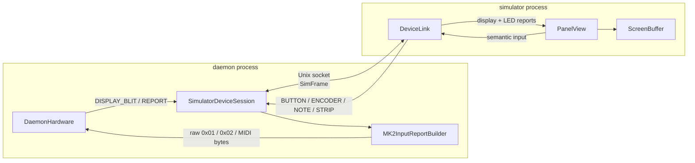

#### Rendering output: pixels, LEDs, and the light guide

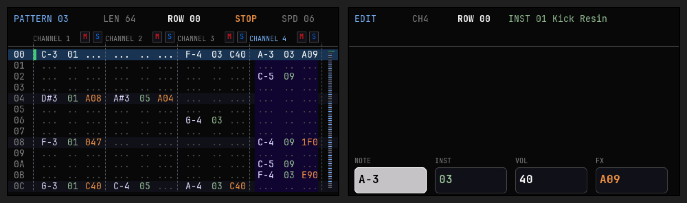

*Both simulator displays rendering a real Kit2 scene (the WidgetLab tracker) — the pixels arrive through the same `displayBlit` frames a hardware panel would receive as `0x84` bulk transfers.*

Display output is the easiest part conceptually and the hardest part to make feel useful.
The daemon already knows how to write a real MK2 display: a bulk transfer with screen
number, rectangle coordinates, dimensions, and big-endian RGB565 pixels. In simulation,
the backend serializes that same blit into a `DISPLAY_BLIT` frame. The AppKit side stores
each 480x272 display in a `ScreenBuffer`, updates only the touched rectangle, and rebuilds
a cached `CGImage` only when needed.

Button LEDs and light guide data come through normal output reports. The simulator does
not invent a separate UI state. If the client writes report `0x80`, `PanelView` receives
the raw LED bytes and paints the buttons accordingly. If the client writes the light-guide
report, the virtual keybed updates from that report. This made several hardware mistakes
visible immediately: the first simulator draft assumed every button could be colored, but
the bench evidence showed only Mute, Solo, F1-F8, and the strip LED slots are palette
capable. Most panel buttons are fixed-colour monochrome indicators.

The simulator follows the hardware model:

- Mute, Solo, F1-F8: palette-capable RGB button lamps.
- Strip LEDs: 25 palette-capable slots.
- Light guide: per-key RGB values from the MK2 light-guide report.
- Play: fixed green monochrome.
- Record: fixed red monochrome.
- Stop and the remaining panel buttons: fixed white monochrome.

For the fixed-colour buttons, the cap is drawn black and the text brightens with the LED
value. That looks odd only until you compare it with the hardware: the real cap is built
the same way. Brightness controls the legend, not a glowing coloured plastic rectangle.

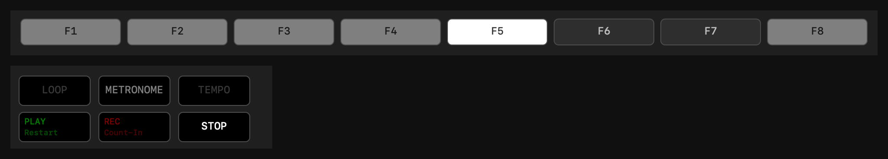

*Top: the RGB-capable F-button row (dim white = available unit, bright white = active). Bottom: fixed-colour monochrome caps — the cap stays black and the legend brightens, Play in green, Record in red, everything else in white, exactly like the hardware.*

#### Rendering input: mouse, keyboard, and explicit touch

The simulator started as a mouse-driven panel: click a button, drag an encoder, scroll on
the 4-D wheel. That was enough for the first transport and LED tests, but it was not enough
for real workflow development. A tracker UI wants to be driven while the terminal or editor
is also open, and the 4-D encoder is central to MK2 navigation. The simulator therefore
grew keyboard mappings and a persistent cheat-sheet window:

- arrow keys push the 4-D encoder
- Return clicks the 4-D encoder
- Shift maps to the hardware Shift button
- `m`, `s`, `i` map to Mute, Solo, Instance
- Space, `r`, Escape map to Play, Record, Stop
- number keys 1-8 map to F1-F8
- bracket/comma/dot keys map to page and preset navigation

This is not meant to replace the hardware. It is meant to make the simulator useful during
normal development, especially with `Stay on Top` enabled and the terminal focused nearby.
Every keyboard action still goes through the same semantic frame path as a mouse action.

Capacitive touch needed special treatment. The real encoders report touch separately from
value change, and a lot of UI behavior depends on "finger resting on encoder" even when no
turn occurred. Mouse rotation events already synthesize touch-on at the start and touch-off
after a short release delay. Command-click on any main encoder or the 4-D rotation control
emits explicit touch/release with no value change, which exercises the same code path as a
real hand resting on the cap.

#### The NO CLIENT mode became a simulator test harness

**Platzhalter: NO CLIENT mode in the simulator, with the right display showing the scrolling timestamped input event log.**

The daemon's NO CLIENT mode began as a hardware safety feature: when no client is
connected, the daemon still owns the surface and can show that it is alive. During
simulation work it became something more useful: a self-contained input inspector.

When no client is attached, the right display shows a timestamped scrolling log of decoded
events. That made it much easier to verify subtle gestures:

- a 4-D click should produce touch/press/release in a believable order
- directional 4-D pushes should show up as left/up/down/right, not just touch changes
- encoder rotation should synthesize touch-on, delta, delayed touch-off
- command-click should produce touch-on/touch-off with no value change
- ribbon release should be visible as position nil
- key slides should become channel pressure only after the grace threshold

The important point is that this is still exercising the daemon path. The log is not a
private simulator overlay. The simulator emits input, the daemon turns it into raw reports,
the regular decoder sees those reports, and the NO CLIENT display renders the decoded
events.

#### Why the GUI is AppKit, not SwiftUI

The simulator is an instrument panel, not a document editor. It needs exact hit regions,
stable geometry, low-latency pointer handling, and immediate redraws from raw framebuffer
updates. AppKit's `NSView` drawing model is a good fit:

- `PanelView` owns the entire virtual device surface.
- `buildLayout()` computes hardware-like rectangles for buttons, displays, encoders,
  wheels, ribbon, strip LEDs, and keybed.
- `draw(_:)` paints the surface from daemon-owned state: display buffers, LED bytes, light
  guide bytes, currently pressed controls, and connection status.
- Mouse and keyboard events are converted into `SimFrame` input.
- `InteractionAudio` keeps a warmed `AVAudioEngine` and round-robin player nodes for low
  latency click/turn feedback.

The window itself is a magnifiable `NSScrollView`. That gives us cheap zoom without
corrupting hit testing, because clicks are converted back into document coordinates. The
View menu grew organically from real use:

- Fit to Width for ordinary desk use.
- True Size for physical-scale inspection.
- Stay on Top for using the simulator next to a terminal.
- Keyboard Cheat Sheet for discoverable mappings.
- Zoom In on Display for focusing on F1-F8, the two displays, and the eight encoders
  without resizing the window.
- KK25/KK37/KK49/KK61 keybed selection, persisted because the simulator often stands in
  for different controller sizes.

**Platzhalter: View menu open, showing Fit to Width, True Size, Zoom In on Display, Stay on Top, Keyboard Cheat Sheet, and keybed-size choices.**

#### The display zoom toggle

The display zoom feature is a good example of the simulator becoming a workbench, not just
a pretty mockup. Most screen-design work happens in the band containing F1-F8, both
displays, and the eight encoders. The keybed and performance controls are important, but
they waste pixels when tuning typography, list density, focus states, or encoder labels.

`Zoom In on Display` (`Command-Z`) stores the current magnification and visible document
origin, computes the largest magnification that fits the display work area inside the
current window content size, and scrolls that region into view. Invoking it again restores
the exact previous zoom and scroll origin. If the window is resized while display zoom is
active, the focused region is refit instead of falling back to Fit to Width.

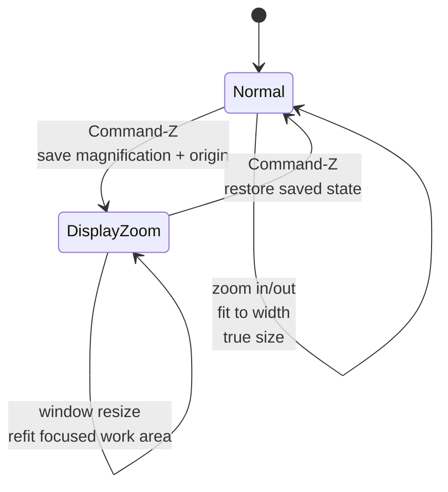

The focus rectangle is not the entire simulator. It is deliberately the union of:

- F1-F8
- display 0 and display 1
- encoder 1 through encoder 8

That matches the part of the MK2 that acts like a compact display-and-parameter editing
surface.

#### Testing the simulator without fooling ourselves

There are two kinds of simulator tests, and they catch different classes of mistakes.

The first kind is pure protocol testing:

- `SimWireCodec` encode/decode round-trips prove local socket framing is stable.
- `MK2InputReportBuilder` round-trips prove semantic events decode as the expected MK2
  input events.
- LED capability tests prevent the UI from pretending fixed-colour buttons can do RGB.

The second kind is manual end-to-end testing:

1. Start the simulator (`make run-simulator` or the built `KontrolSimulator` executable).
2. Start the daemon in simulation mode (`make daemon-simulate`, or `CCD_SIMULATE=... ccd`).
3. Run a client such as `MK2WidgetLabDemo`.
4. Interact with the virtual controls.
5. Verify the client reacts exactly as it does on hardware.

That last sentence is the whole point. The simulator is useful only because the client is
not linked to it. The client still talks to `ccd`; `ccd` still speaks raw MK2 reports to
clients; only the lowest device session changed.

#### What the simulator deliberately does not prove

KompleteSimulator is high fidelity, not omniscient. It cannot prove USB timing margins,
firmware buffering behavior, electrical keybed scanning edge cases, or whether Native
Instruments changed something in a hardware revision. It also cannot prove whether a
colour looks identical through the real diffuser plastics. Anything involving actual USB
ownership, endpoint stalls, firmware recovery, or human perception on the physical caps
still needs the bench.

What it does prove is still extremely valuable: the software stack above the USB endpoint
can be exercised continuously, with real daemon framing, real raw reports, real display
blits, real LED capability constraints, and a UI that is close enough to reveal layout and
workflow mistakes before the hardware is touched.

#### File map

| Area | Files |
| --- | --- |
| Local simulator wire protocol | `Sources/KompleteKontrol/SimWireProtocol.swift` |
| Raw report synthesis | `Sources/KompleteKontrol/MK2InputReportBuilder.swift` |
| Daemon backend | `Sources/KompleteKontrol/SimulatorDeviceSession.swift` |
| GUI socket link | `Tools/KontrolSimulator/DeviceLink.swift` |
| GUI panel and input | `Tools/KontrolSimulator/PanelView.swift` |
| Window/menu/persistence | `Tools/KontrolSimulator/main.swift` |
| App icon | `Tools/KontrolSimulator/SimulatorAppIcon.swift` |
| Design record | `Docs/Simulator-Plan.md` |

### The byte that bit me

```
correct:  84 00 00 60 00 00 00 00  00 00 00 00 01 e0 01 10 ...   width = 0x01e0 = 480
buggy:    84 00 00 60 00 00 00 00  00 00 00 00 e0 01 01 10 ...   width = 0xe001 = 57345
                                               ^^^^^
```

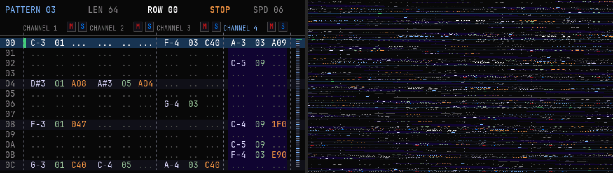

*Reproduction: the same frame decoded once with the correct big-endian width and once with the byte-swapped width the bug produced — every "row" starts 57,345 pixels further into the stream, shredding the image into diagonal noise.*

The MK2 display blit header uses **big-endian** for X/Y/width/height and pixel count. Everything else in the protocol is little-endian or single-byte. I spent an afternoon wondering why my display blits were producing garbled rectangles at wrong coordinates. The answer: I was writing width as little-endian `e0 01` instead of big-endian `01 e0`. The display controller was reading 0xe001 = 57345 as the width. Of course it produced garbage.

If there's one thing to take away from this guide, it's this: **always check endianness**. The MK2 protocol mixes endianness within a single report. The display header is BE, the pixel data is BE, but the input report encoders are LE. There's no consistent rule. You just have to know which is which. And now you do.

---

## Appendix A: MK2 button LED index reference

Complete index map for report `0x80` (host-control mode):

| Index | Button | RGB? | Index | Button | RGB? |
| --- | --- | --- | --- | --- | --- |
| 0 | Mute | **yes** | 22 | Preset Up | no |
| 1 | Solo | **yes** | 23 | Track | no |
| 2 | F1 | **yes** | 24 | Loop | no |
| 3 | F2 | **yes** | 25 | Metro | no |
| 4 | F3 | **yes** | 26 | Tempo | no |
| 5 | F4 | **yes** | 27 | Preset Down | no |
| 6 | F5 | **yes** | 28 | Key Mode | no |
| 7 | F6 | **yes** | 29 | Play | no (green) |
| 8 | F7 | **yes** | 30 | Record | no (red) |
| 9 | F8 | **yes** | 31 | Stop | no (white) |
| 10 | Jog Left | no | 32 | Page Left | no |
| 11 | Jog Up | no | 33 | Page Right | no |
| 12 | Jog Down | no | 34 | Clear | no |
| 13 | Jog Right | no | 35 | Browser | no |
| 14 | Shift | no | 36 | Plugin | no |
| 15 | Scale | no | 37 | Mixer | no |
| 16 | Arp | no | 38 | Instance | no |
| 17 | Scene | no | 39 | MIDI | no |
| 18 | Undo/Redo | no | 40 | Setup | no |
| 19 | Quantize | no | 41 | Fixed Vel | no |
| 20 | Auto | no | 42–43 | Octave Down/Up (host writes ignored) | no |
| 21 | Pattern | no | 44–68 | Strip LEDs | **yes** |

## Appendix B: MK2 palette colour table

| Code | Index | Intensity | Colour | RGB |
| --- | --- | --- | --- | --- |
| `0x00` | — | — | off | `000000` |
| `0x04` | 1 | 25% | red dim | `400000` |
| `0x05` | 1 | 50% | red med | `800000` |
| `0x06` | 1 | 75% | red bright | `c00000` |
| `0x07` | 1 | 100% | red full | `ff0000` |
| `0x08` | 2 | 25% | orange-red dim | `401000` |
| ... | ... | ... | ... | ... |
| `0x46` | 17 | 75% | white bright | `bfbfbf` |
| `0x47` | 17 | 100% | white full | `ffffff` |

Pattern: `code = (index << 2) | intensity`. Index 1–17, intensity 0–3. Code 0 = off.

## Appendix C: MK2 input report button bit map

| Byte | Bit 7 | Bit 6 | Bit 5 | Bit 4 | Bit 3 | Bit 2 | Bit 1 | Bit 0 |
| --- | --- | --- | --- | --- | --- | --- | --- | --- |
| 1 | F4 | F3 | F2 | F1 | F8 | F7 | F6 | F5 |
| 2 | Shift | Undo/Redo | Loop | Play | Scale | Arp | Quantize | Auto |
| 3 | Page Left | Preset Down | Page Right | Preset Up | Metro | Tempo | Record | Stop |
| 4 | — | Key Mode | Clear | Track | Pattern | Scene | Solo | Mute |
| 5 | — | — | MIDI | Instance | Setup | Browser | Plugin | Mixer |
| 8 | — | — | — | — | — | Fixed Vel | Octave Up | Octave Down |
| 6 | Push R | Push D | Push U | Push L | Click | Touch | — | — |
| 7 | Enc 1 | Enc 2 | Enc 3 | Enc 4 | Enc 5 | Enc 6 | Enc 7 | Enc 8 |

Bit is set when the button/encoder is pressed/touched. Edges are detected by XORing consecutive reports.

---

*This guide represents the state of reverse-engineering as of the time of writing. The MK3 ODR protocol table was recovered from firmware analysis and may contain errors in parameter types or method IDs. The MK2 protocol has been bench-verified on an S61 MK2 (the S49/S88 differences — key count, light-guide note offset — come from the USB descriptors and community sources). If you find something wrong, it's probably because NI changed it in a firmware update — or because I made a mistake. Possibly both. Check with a logic analyzer before you ship anything.*
