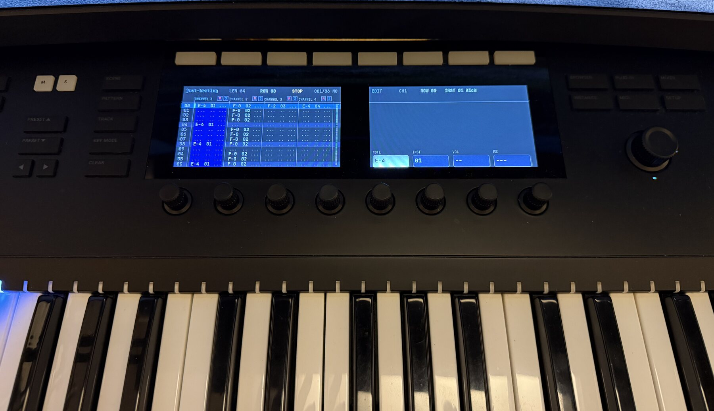
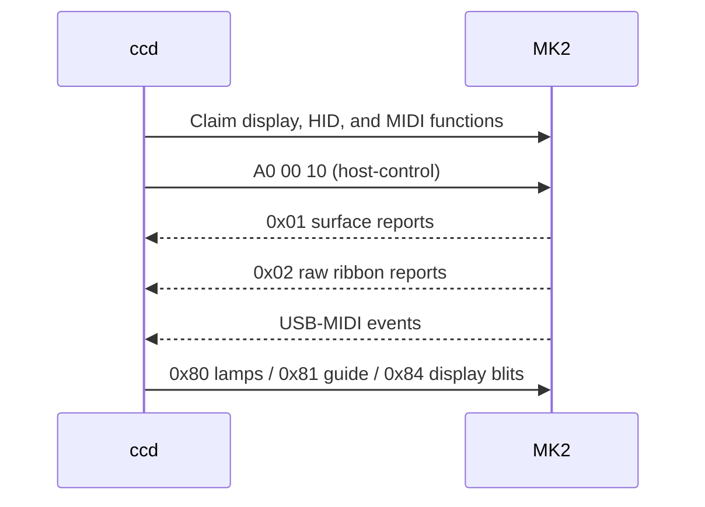
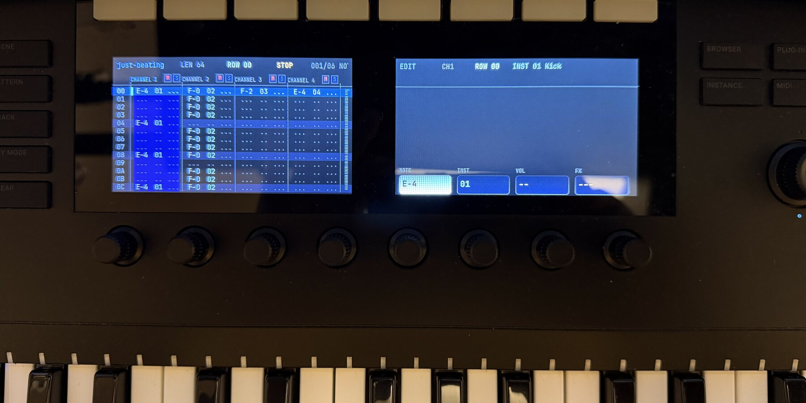
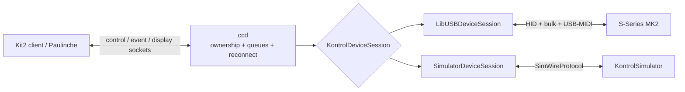

# CompleteControl Native Instruments Protocol Guide

This is the maintained protocol reference for the Native Instruments devices
implemented by CompleteControl. The production path supports Komplete Kontrol
S49/S61/S88 MK2. MASCHINE MK3 has a first-class device profile, safe daemon
ownership, two displays, a semantic NO CLIENT decoder, and a focused
hardware-verified Kit2 compatibility adapter. Pad input, pressure state, and
pad LED ordering are bench-verified on the unit identified below; remaining
source-derived surface details stay labelled until their focused bench passes
are recorded.

Unless stated otherwise, findings were bench-verified on an S61 MK2 and are
encoded in `KompleteKontrolMK2.swift`, `KontrolUSB.c`, and their tests. Values
for the S49/S88 variants come from the device descriptors used by the driver.

CompleteControl targets MK2 because it exposes the combination required by a
custom tracker surface:

- two host-owned 480x272 RGB565 displays;
- full-surface button, encoder, 4-D wheel, and ribbon input;
- host-controlled button lamps, strip LEDs, and light guide;
- standard USB-MIDI for the keybed and performance controls.



## MASCHINE MK3 bench profile

The following transport facts were read directly from a connected MASCHINE MK3
on 2026-07-17. The tested unit reports firmware/device revision `bcdDevice
0x0146`, USB VID/PID `0x17cc:0x1600`, and a maximum bus current of 480 mA.

Native Instruments' own `MC3Updater` derives the version string it displays
("1.4.6") from this same standard `bcdDevice` field — read via the generic
`IOUSBDeviceInterface.GetDeviceReleaseNumber()` call, immediately after the
equally generic `GetDeviceVendor`/`GetDeviceProduct` — and formats it as BCD
nibbles: high byte is major, the low byte's high nibble is minor, its low
nibble is patch. No vendor-specific query is involved, so the daemon's
`deviceInfo` message reports it the same way (`KKDeviceInfo` in
`DaemonBinaryProtocol.swift`).

| Interface | Function | Endpoints | CompleteControl ownership |
| ---: | --- | --- | --- |
| 0 | USB Audio control | none | Never claimed; left to macOS audio |
| 1 | USB Audio streaming output | isochronous OUT `0x01` | Never claimed; left to macOS audio |
| 2 | USB Audio streaming input | isochronous IN `0x81` | Never claimed; left to macOS audio |
| 3 | USB-MIDI streaming | bulk OUT `0x02`, bulk IN `0x82` | Not claimed during MK3 bring-up |
| 4 | HID surface | interrupt OUT `0x03`, interrupt IN `0x83`, 64-byte maximum packets | Claimed by the daemon |
| 5 | Colour displays | bulk OUT `0x04`, 512-byte maximum packets | Claimed by the daemon |
| 6 | Device firmware upgrade | none | Never claimed |

This ownership boundary is deliberate. The daemon must not detach or disturb
interfaces 0-2, so MASCHINE MK3 remains available as a 48 kHz, two-input,
four-output Core Audio device while CompleteControl owns the surface. Interface
3 remains unclaimed until its intended DIN/USB-MIDI role is established.

The HID report descriptor provides these exact wire sizes, including the report
ID byte:

| Direction | Report ID | Total/payload size | Bring-up role |
| --- | --- | ---: | --- |
| IN | `0x01` | 42 bytes total | Surface buttons, encoders, touch strip, pedal |
| IN | `0x02` | 64 bytes total | Pad pressure samples |
| OUT | `0x80` | 62-byte payload | Button, group, and main-encoder LEDs |
| OUT | `0x81` | 41-byte payload | Touch-strip and pad LEDs |

The 64-byte pad report corrects an earlier research-note assumption based on a
public implementation's 128-byte receive buffer. Bench captures show that its
63-byte payload partitions exactly into 21 three-byte record slots; unused slots
are zero, and one report can carry records for several pads. Public sources agree
that a record is `(hardware pad index, encoded high byte, encoded low byte)`, with
a `0x4xxx` marker and a 12-bit pressure value in the low bits. CompleteControl
decodes that source-confirmed shape while retaining every raw record.

A controlled live trace on 2026-07-18 established the parts the public notes
discarded. A below-trigger contact emits `0x0xxx` and ends with `0x2xxx`; a
triggered strike emits `0x1xxx` and ends with `0x3xxx`. The lower 12 bits carry
the contact/strike magnitude. Zero or more `0x4xxx` words carry independent
12-bit pressure while held. CompleteControl therefore exposes touch-only,
strike velocity (`0...4095`), pressure (`0...4095`), and release separately.
This also explains why simply discarding every non-`0x4xxx` slot loses the
hardware's lowest-latency onset signal, while treating `0x0xxx` as a note strike
creates impossible velocity-zero notes from light touches.

A controlled physical Pad 1...16 pass verified the input matrix on bcdDevice
`0x0146`: hardware indices 12-15 are Pads 1-4, 8-11 are Pads 5-8, 4-7 are Pads
9-12, and 0-3 are Pads 13-16. Record slot 3 also carries the fixed neutral
triplet `0d 40 00` throughout unrelated pad activity. It is padding/sentinel
state, not a Pad 13 release or evidence of a faulty pressure sensor: a genuine
hardware-index 13 pressure stream appears independently in slot 0 when physical
Pad 2 is moved. The decoder filters only that exact slot/triplet combination,
and the state tracker emits a release only after the same hardware index has
previously reported a touch or strike.

On macOS, a 256-byte libusb transfer buffer was observed coalescing four logical
64-byte pad reports into one callback. The MK3 device profile therefore sizes
the interrupt transfer to the endpoint's 64-byte maximum packet size; each
callback delivered upstream is one logical HID report.

### MK3 source hierarchy

Protocol facts are accepted in this order:

1. the connected unit's USB/HID descriptors and controlled CompleteControl
   bench captures;
2. agreement between the
   [cabl MK3 documents](https://github.com/Drachenkaetzchen/cabl/tree/develop/doc/hardware/maschine-mk3),
   [ktemkin's reverse-engineering notes](https://gist.github.com/ktemkin/89253ecf10c5078f47607776564de83b),
   and the
   [openAV-Ctlra MK3 driver](https://github.com/RufusIbiza/openAV-Ctlra/blob/feature/maschine-mk3-support/ctlra/devices/ni_maschine_mk3.c);
3. a single public implementation, kept source-derived until a bench capture
   confirms it.

`qKontrol` and `SynthesiaKontrol` corroborate the S-Series MK2 host-control,
mapping, and light-guide families but do not decode MASCHINE MK3. The old cabl
C++ implementation also contains prototype-era PID/report values (`0x1601`,
`0x20`, and incompatible LED report partitions); those values are deliberately
excluded. cabl's later protocol documents are used only where they agree with
the descriptor, ktemkin, openAV-Ctlra, or the bench unit.

### MK3 report `0x01`: semantic surface candidates

Offsets include the report ID at byte 0:

| Byte(s) | Source-derived content |
| --- | --- |
| 1 | Main encoder press/up/right/down/left, Shift, display button 8; bit 1 remains ambiguous/pedal-related |
| 2 | Group A-H |
| 3 | Notes, Volume, Swing, Tempo, Note Repeat, Lock; bits 6-7 remain pedal-related candidates |
| 4 | Pad Mode, Keyboard, Chords, Step, Fixed Velocity, Scene, Pattern, Events |
| 5 | Variation, Duplicate, Select, Solo, Mute, Pitch, Mod; bit 0 is microphone-presence related |
| 6 | Perform, Restart, Erase, Tap, Follow, Play, Record, Stop |
| 7 | Macro, Settings, Arrow Right, Sampling, Mixer, Plug-in |
| 8 | Channel, Arranger, Browser, Arrow Left, File, Auto |
| 9 | Display buttons 1-7 and main-encoder touch |
| 10 | Encoder touches 1-8, bit 7 through bit 0 |
| 11 low nibble | Main encoder counter, modulo 16 |
| 12-27 | Eight little-endian 10-bit encoder counters; source implementations treat the wrap as modulo 1000 |
| 28-35 | Two four-byte touch-strip/finger groups; positions are read at 30-31 and 34-35 |
| 36-41 | Microphone gain, headphone volume, and master volume as little-endian 16-bit values |

The decoder emits named button edges, encoder deltas/touches, touch-strip
positions, and the three analogue controls. Changes to ambiguous bits are never
dropped: they appear as `rawChanged` events in NO CLIENT so a focused capture can
promote them later.

### Kit2 compatibility adapter

`MK2Surface2` now selects a device adapter from the daemon's structured
`KKDeviceInfo`. Existing scenes and applications retain their current
`KKMK2InputEvent`/`KKMK2ButtonLED` vocabulary: the adapter lowers native MK3
input directly into that compatibility vocabulary and encodes the same scene
lamp state back into native MK3 reports. It never constructs a fake MK2 USB
report, so MK3 input stays on the same actor and scheduling path used by MK2.

The source-derived compatibility policy implemented for the first hardware pass
is intentionally one-to-one:

| Existing Kit2 meaning | MK3 control |
| --- | --- |
| Function 1-8 | Display buttons 1-8 |
| Encoder 1-8 turn/touch | Display encoders 1-8 turn/touch |
| 4-D turn/touch/confirm/directions | Main encoder turn/touch/release-confirm/directions |
| Ribbon | Touch strip, with deterministic primary-contact lowering |
| Shift, Scene, Pattern, Variation, Auto, Tempo | Same-labelled MK3 buttons |
| Play, Record, Stop | Same-labelled MK3 transport buttons |
| Browser, Plug-in, Mixer | Same-labelled MK3 mode buttons |
| Mute, Solo, Fixed Velocity | Mute, Solo, Fixed Velocity |
| Setup, Clear | Settings, Erase |
| Page Left/Right | Arrow Left/Right |
| Track, Key Mode | Channel, Keyboard |

The touch-strip adapter retains both native finger positions. Finger 1 is the
primary compatibility contact while present; if it leaves while finger 2
remains, the stream hands over to finger 2 without a false release. A release is
emitted only after the final contact leaves. The MK2-style millisecond field is
synthesized from the daemon's monotonic input timestamp. Existing Strip 1-25
lamp state maps to MK3 report `0x81` slots 0-24.

`MK2WidgetLabDemo` uses the direct MK3 **Variation** control as its local
sub-demo switcher. On MK2 it continues to use **Instance**. `Variation` is a
logical MK3-only Kit2 control (outside the MK2 LED report range), so the
projection does not create an invalid MK2 USB write. This is a Widget-Lab-only
projection; the Kit2 Shift layer stays entirely unchanged.

Misleading aliases are deliberately absent: Restart is not Loop, Tap is not
Metronome, Note Repeat is not Arp, Chords is not Scale, Duplicate is not
Undo/Redo, and the arrow buttons are not Preset Up/Down. MK3-only controls remain
available to the native decoder but do not impersonate an existing Kit2 action.
The 16 pads remain outside the MK2 button compatibility map. Kit2 exposes their
timed native touch, strike, pressure, and release stream as
`KontrolSurfacePadEvent` for calibration and diagnostics. In parallel,
`KontrolPadMIDISynthesizer` translates triggered pads into the ordinary Kit2
MIDI route used by MK2 USB-MIDI: physical Pads 1-16 map to notes 36-51 on MIDI
channel 1, a strike emits Note On, held pressure emits MIDI polyphonic key
pressure, and release emits Note Off with velocity zero. Every received strike
maps to velocity `1...127`, since a MIDI Note On with velocity zero means Note
Off; pressure retains its full `0...127` range. Touches that never cross the
hardware strike threshold produce no MIDI note. The mapping, independent linear
calibration ranges, optional fixed velocity, and pressure emission policy are
configurable through `MK2Surface2.Options.padMIDIMapping`.

The daemon does not synthesize those notes and still does not claim the MK3's
USB-MIDI interface 3. It forwards timestamped native pad reports; Kit2 performs
the musical policy transformation on the same ordered actor path and feeds the
result into `MK2InputBindings2.midiFocus` or `midi`. Consequently existing Kit2
clients such as Paulinche receive MK3 pad notes through the same binding as MK2
keybed notes, while low-level daemon clients continue to see the native surface
stream. `MK2WidgetLabDemo`'s hardware-neutral MIDI Monitor makes held notes,
chords, velocities, and pressure visible for both device families.

The Widget Lab hardware passes on 2026-07-17 and 2026-07-18 verified the shared
input map, including first-event main-encoder delivery, and calibrated both LED
families. Monochrome backlights use a non-linear low-bit order: `0x05` is almost
dark, `0x04` is a useful soft state, `0x06` is bright, and `0x07` is maximum.
Kit2 therefore maps semantic intensities 1, 2, and 3 to `0x04`, `0x06`, and
`0x07`; zero remains off.

Group A-H, the four point LEDs in the 4-D encoder halo, and all 16 pads use the
16-hue RGB palette with four linearly increasing brightness-bit values 0...3.
Browser is monochrome. Sampling is a hardware hybrid: coloured palette entries
use the linear RGB curve, while both tested white encodings use the non-linear
monochrome order. This bench result resolves the older public-source conflict:
openAV-Ctlra classified Sampling as RGB, while cabl and ktemkin classified it as
monochrome.

### MK3 reports `0x80` and `0x81`: LED indices

The output lengths come from the HID descriptor; public tables occasionally
count the report ID as payload and are off by one. CompleteControl always uses a
62-byte payload for `0x80` and a 41-byte payload for `0x81`.

| Report/range | Assignment |
| --- | --- |
| `0x80` 0-11 | Channel, Plug-in, Arranger, Mixer, Browser, Sampling, arrows, File, Settings, Auto, Macro |
| `0x80` 12-19 | Display buttons 1-8 |
| `0x80` 20-28 | Volume, Swing, Note Repeat, Tempo, Lock, Pitch, Mod, Perform, Notes |
| `0x80` 29-36 | Group A-H |
| `0x80` 37-57 | Restart through Mute in the documented panel order |
| `0x80` 58-61 | Main encoder Up, Left, Right, Down LEDs |
| `0x81` 0-24 | 25 touch-strip LEDs, left to right |
| `0x81` 25-40 | Pads 13-16, 9-12, 5-8, 1-4 |

These indices are represented by `MaschineMK3ButtonLED` and
`MaschineMK3PadLED`. NO CLIENT uses them as an intentionally simple hardware
echo: a documented button edge switches its matching lamp on/off, pad pressure
above the source-derived reference threshold of 128 switches the candidate pad
slot on/off, and each reported touch position selects one of the 25 strip LEDs.
Monochrome button slots use maximum brightness `0x07`; Sampling, Group A-H, the
four 4-D encoder halo dots, pads, and strip use maximum white `0xff`. The older
`0x4e` value remains documented as an alternate white reference at RGB
brightness level 2. Main
encoder press and ambiguous input bits are not animated because no matching
lamp is established for them.

The pad hardware-index-to-LED mapping follows openAV-Ctlra directly and is now
bench-verified: hardware indices 0-15 write payload offsets 25-40. Pads 15 and 2
are the useful cross-check for the bottom-up matrix: physical Pad 15 arrives as
hardware index 2 and lights payload slot 27; physical Pad 2 arrives as index 13
and lights slot 38. The simple NO CLIENT on/off threshold of 128 remains a
source-derived diagnostic choice rather than part of the semantic pad contract.

The first NO CLIENT implementation serialized pad-driven OLED redraws and LED
writes. On the MK3, two approximately 40-50 ms full-frame display transfers then
delayed LED feedback: a 32-edge trace measured 44 ms median, 50 ms P95, and 51 ms
maximum from input callback to LED-write start. State reports now drain on their
own serial queue while OLED bulk transfers run independently. A repeat hardware
pass across all pads paired 104 LED on/off edges at 1 ms trace resolution:
0 ms median and 2 ms maximum, while concurrent OLED frames still took 40-47 ms.
This is daemon callback-to-USB-write-start evidence; it does not claim optical
or finger-to-device latency below the trace resolution.

The two panels are 480x272 RGB565 and use display interface 5/endpoint `0x04`.
CompleteControl initially reuses the S-Series `0x84` display command family and
the existing renderer/diffing stack. Exact command-dialect compatibility is a
bench-test result, not inferred from the shared resolution.

Safe diagnostics:

```bash
make maschine-mk3-probe
make maschine-mk3-input-spy MASCHINE_MK3_INPUT_SPY_SECONDS=10
make daemon-debug
```

The first command only reads descriptors and claims no interfaces. The second
stops the daemon and claims only HID interface 4. `MK2USBSpy` refuses an MK3
capture without an explicit interface selection before initializing libusb.
The third starts the normal daemon; with no client connected, its displays show
decoded events and the LEDs perform the input/output echo described above.

## MK2 device identity and transport

### Supported models

| Model | PID | Keys | Light-guide note offset |
| --- | --- | ---: | ---: |
| S49 MK2 | `0x1610` | 49 | -36 |
| S61 MK2 | `0x1620` | 61 | -36 |
| S88 MK2 | `0x1630` | 88 | -21 |

The light-guide mapping is:

```text
keyIndex = midiNote + lightGuideNoteOffset
```

Thus MIDI note 36 maps to key 0 on S49/S61, and note 21 maps to key 0
on S88.

### Relevant USB functions

The production daemon uses one libusb device handle and discovers the HID and
USB-MIDI streaming endpoints from the active configuration. It does not rely on
a hard-coded surface-input endpoint address.

| Function | Transport used by CompleteControl |
| --- | --- |
| Surface input | HID interrupt IN endpoint(s), discovered from HID interfaces |
| Surface output (`0x80`, `0x81`, `0xA0`–`0xA4`, `0xAF`) | HID `SET_REPORT` control transfer to the discovered surface interface |
| Displays | Interface 3, bulk OUT endpoint `0x03` |
| MIDI input | USB-MIDI streaming IN endpoint, discovered by class/subclass; S61 MK2 uses bulk IN `0x81` |

Interface 3 is the descriptor's initial claim/display interface for every
supported MK2 model. The daemon may additionally claim discovered HID and MIDI
interfaces. NI software or macOS drivers can already own them, so `ccd` is the
single privileged USB owner and applications connect through its Unix sockets.

The MIDI endpoint has a 512-byte `wMaxPacketSize`; the asynchronous libusb MIDI
buffer must also remain 512 bytes. A smaller 256-byte buffer caused short MIDI
transfers, especially note-offs, to remain pending until later input arrived.

### Daemon scheduling boundary

Surface and MIDI input use permanently resubmitted asynchronous libusb transfers.
The libusb poll fds are watched by the daemon's kqueue reactor. Display and small
state-report output use separate serial queues and may run concurrently because
they target different endpoints.

Synchronous libusb output calls can dispatch asynchronous callbacks reentrantly.
Pending-state drains must therefore re-check their flags after output writes;
they cannot assume another kqueue edge will arrive. The detailed invariant lives
in `Docs/daemon-usb-reactor.md`.

---

## MK2 modes and mapping engine

### Report `0xA0`: mode selection

`0xA0` has a two-byte payload:

| Payload | Mode | Behaviour |
| --- | --- | --- |
| `00 10` | Host-control | Host owns surface lamps and strip LEDs through `0x80`; ribbon streams raw report `0x02`; keybed/wheels remain USB-MIDI |
| `93 00` | Mapping engine | Firmware generates MIDI from templates `0xA1`–`0xA4` and owns the associated function/ribbon behaviour |
| `00 00` | Engine off, not host-control | Ribbon and mapping templates are silent; this is not the desired custom-driver mode |

CompleteControl enters host-control mode with:

```text
A0 00 10
```

No template upload is required for normal host-control operation. The mapping
templates are dormant until the mapping engine is enabled.

### Mapping templates

The mapping engine matters when configuring standalone-controller behaviour and
when handing the keyboard back during daemon shutdown.

| Report | Purpose | Payload |
| --- | --- | ---: |
| `0xA1` | Buttons and eight rotary assignments | 203 bytes |
| `0xA2` | Pitch wheel, mod wheel, ribbon | 44 bytes |
| `0xA3`, `0xA4` | Additional firmware templates | Not emitted or decoded by CompleteControl; do not write unverified data |
| `0xAF` | Commit mapping | `00 02` |

`0xA2` contains three 12-byte slots followed by an 8-byte trailer. The verified
default is pitch bend, CC1, and ribbon CC11:

```text
06 00 00 00 00 00 ff 3f 00 00 01 00  # pitch bend
03 01 00 20 00 00 7f 00 00 00 00 00  # mod wheel, CC1
03 0b 00 20 00 00 7f 00 00 00 00 00  # ribbon, CC11
00 00 00 00 00 00 00 00              # trailer
```

The public `AnalogAssignment` encoder supports:

- `off`: twelve zero bytes;
- unipolar CC: assignment type `0x03`, channel/range encoded in the slot;
- bipolar pitch bend: assignment type `0x06`; for a bipolar ribbon, trailer byte
  0 controls decay and trailer byte 3 is `0x02` for a centre-origin LED display.

### Bring-up and shutdown

Normal MK2 bring-up is deliberately small:



On orderly daemon shutdown, CompleteControl restores a usable standalone state:

```text
A0 93 00                       # mapping engine on
A1 <factory-like CC14–21 map>  # rotary assignments
A2 <pitch / CC1 / CC11 map>    # wheels and ribbon
AF 00 02                       # commit
80 <79 zero bytes>             # clear lamps
81 <249 zero bytes>            # clear light guide
84 <black frame per screen>    # clear displays
```

`A0 00 00` is intentionally absent: it disables the engine without entering
host-control mode.

---

## MK2 input

### Report `0x01`: surface input

The decoder treats report `0x01` as a state snapshot and derives edges by
comparing it with the preceding report. These are the decoded offsets:

| Byte(s) | Content |
| --- | --- |
| 0 | Report ID `0x01` |
| 1 | F5–F8 in bits 0–3; F1–F4 in bits 4–7 |
| 2 | Auto, Quantize, Arp, Scale, Play, Loop, Undo/Redo, Shift |
| 3 | Stop, Record, Tempo, Metro, Preset Up, Page Right, Preset Down, Page Left |
| 4 | Mute, Solo, Scene, Pattern, Track, Clear, Key Mode |
| 5 | Mixer, Plugin, Browser, Setup, Instance, MIDI |
| 6 | 4-D touch/click/directional state |
| 7 | Encoder touch bits, bit 7 = encoder 1 through bit 0 = encoder 8 |
| 8 | Octave Down, Octave Up, Fixed Velocity |
| 10–25 | Eight 16-bit little-endian rotary counters |
| 26–29 | Declared wheel fields; not populated on the bench-tested firmware |
| 30 low nibble | 4-D rotation counter, modulo 16 |

The eight main rotary counters run from 0 through 999 and wrap modulo 1000.
Decode their movement with a wrapped delta; modulo 1024 is wrong at the wrap
point. Touch is independent of rotation.

The 4-D state byte is:

| Value | State |
| --- | --- |
| `0x00` | Released |
| `0x04` | Cap touched |
| `0x0c` | Click while touched |
| `0x14` | Push left while touched |
| `0x24` | Push up while touched |
| `0x44` | Push down while touched |
| `0x84` | Push right while touched |

Directional and click values already include the touch bit. Returning from a
push/click to `0x04` is the centre transition; returning to `0x00` releases touch.

### Report `0x02`: raw ribbon

In host-control mode the ribbon emits an 11-byte report at roughly 100 Hz while
touched:

| Byte(s) | Content |
| --- | --- |
| 0 | Report ID `0x02` |
| 1–2 | Observed constant, little-endian |
| 3–4 | Observed constant, little-endian |
| 5–6 | Millisecond time value, little-endian |
| 7–8 | Position 0–1024, little-endian; 0 means released |
| 9–10 | Zero in verified captures |

In mapping-engine mode this raw report is silent; the ribbon follows its `0xA2`
assignment and produces MIDI instead.

### Report `0xAA`: mapping-engine mirror

`0xAA` is a high-rate HID mirror emitted while the mapping engine is active. It
is not part of the host-control input contract and the daemon's idle diagnostic
intentionally ignores it. Use USB-MIDI for the engine's musical output.

### USB-MIDI

Keybed, pitch wheel, mod wheel, and mapping-engine output arrive as standard
four-byte USB-MIDI event packets. The decoder handles note on/off, control
change, channel pressure, and pitch bend. In host-control mode the ribbon stays
on raw HID report `0x02` rather than producing MIDI.

---

## MK2 output

### Report `0x80`: button and strip LEDs

The complete report is 80 bytes: report ID plus a 79-byte payload. Known indices
are 0–68; the remaining payload bytes stay zero.

| Range | Assignment |
| --- | --- |
| 0–1 | Mute, Solo |
| 2–9 | F1–F8 |
| 10–14 | 4-D Left/Up/Down/Right, Shift |
| 15–41 | Remaining panel buttons through Fixed Velocity |
| 42–43 | Octave Down/Up; host writes were not observed to light them |
| 44–68 | 25 ribbon LED segments |

Only Mute, Solo, F1–F8, and the 25 ribbon segments are palette-colour capable.
The other panel indicators are fixed-colour monochrome lamps:

- Play is green;
- Record is red;
- the remaining indicators are white.

For monochrome controls, the requested colour is reduced to intensity. Sending a
blue value cannot turn the Record lamp blue.

### Report `0x81`: light guide

The complete report is 250 bytes: report ID plus a 249-byte payload. The first
49, 61, or 88 entries are meaningful for the supported model; unused entries
remain zero.

Each byte uses a firmware palette:

```text
bits 7–2: palette index 1–17
bits 1–0: intensity 0–3 (25%, 50%, 75%, 100%)
0x00: off
```

The encoder is:

```text
code = (paletteIndex << 2) | intensity
```

For example, full red is `(1 << 2) | 3 = 0x07`; the lowest red
intensity is `0x04`.

| Index | Colour | RGB | Index | Colour | RGB |
| ---: | --- | --- | ---: | --- | --- |
| 1 | Red | `ff0000` | 10 | Azure | `007fff` |
| 2 | Orange-red | `ff3f00` | 11 | Blue | `0000ff` |
| 3 | Orange | `ff7f00` | 12 | Indigo | `3f00ff` |
| 4 | Amber | `ffcf00` | 13 | Violet | `7f00ff` |
| 5 | Yellow | `ffff00` | 14 | Magenta | `ff00ff` |
| 6 | Chartreuse | `7fff00` | 15 | Pink | `ff007f` |
| 7 | Green | `00ff00` | 16 | Rose | `ff003f` |
| 8 | Spring green | `00ff7f` | 17 | White | `ffffff` |
| 9 | Cyan | `00ffff` | | | |

CompleteControl maps arbitrary RGB requests to the nearest palette entry by
squared Euclidean RGB distance.

### Report `0x84`: display blit

The displays accept arbitrary RGB565 rectangles through interface 3, bulk OUT
endpoint `0x03`. The packet is not a HID report despite the `0x84` command byte.



```text
Offset  Size  Content
0       2     84 00
2       1     Screen: 0 left, 1 right
3       5     60 00 00 00 00
8       2     X, u16 big-endian
10      2     Y, u16 big-endian
12      2     Width, u16 big-endian
14      2     Height, u16 big-endian
16      6     02 00 00 00 00 00
22      2     Pixel count / 2, u16 big-endian
24      ...   RGB565 pixels, big-endian halfwords, row-major
...     12    02 00 00 00 03 00 00 00 40 00 00 00
```

Validated geometry and size rules:

- screen is 0 or 1;
- `x + width <= 480`, `y + height <= 272`;
- width and height are non-zero;
- the pixel count must be even;
- `pixelCount / 2` must fit in a 16-bit field;
- payload length is exactly `width × height × 2` bytes.

A full 480×272 screen has 130,560 pixels, so the count field is 65,280
(`0xff00`). A complete packet is 261,156 bytes including header and trailer.

Full-screen header for the left display:

```text
84 00 00 60 00 00 00 00 00 00 00 00 01 e0 01 10
02 00 00 00 00 00 ff 00
```

The important endianness rule is asymmetric: display coordinates, dimensions,
count, and RGB565 pixels are big-endian; rotary counters and ribbon fields are
little-endian.

### Experimental display command verification

The colour-display command stream has two additional operations first reported
by cross-device reverse engineering and subsequently bench-verified on the
S-Series MK2:

| Opcode | Proposed operation | MK2 status |
| --- | --- | --- |
| `0x00` | Copy the following RGB565 pixel pairs | Verified; this is the production writer's baseline |
| `0x01` | Repeat the following RGB565 pixel pair | Confirmed on hardware 2026-07-14, including chained multi-segment packets |
| `0x02` | Skip the given number of pixel pairs | Non-zero skip confirmed on hardware 2026-07-14, including multiple skips per packet |
| `0x03` | Commit/blit | Verified as part of the baseline packet |
| `0x40` | End transfer | Verified as part of the baseline packet |

Chaining more than one skip/literal/repeat segment into a single packet is
also confirmed — see below.

Each token is four bytes: an opcode followed by a 24-bit big-endian pair count.
The S-Series screen geometry needs at most 65,280 pairs, so the high count byte
is zero in all current packets. `0x01` is described in the
[earlier cabl MK3 reverse engineering](https://github.com/shaduzlabs/cabl/issues/9#issuecomment-353465032);
a [later packet capture](https://github.com/shaduzlabs/cabl/issues/9#issuecomment-2704220812)
documents `0x02` as advancing the current pixel position by twice its pair
count. The newer
[RufusIbiza openAV-Ctlra feature branch](https://github.com/RufusIbiza/openAV-Ctlra/tree/feature/maschine-mk3-support/resources/maschine_mk3)
corroborates the encodings in its `ni_screen_line` and `ni_screen_skip` helpers.
Its current zone-update path, however, uses rectangle geometry followed by an
`0x00` literal block rather than either helper. These therefore remain
colour-display-family hypotheses until the REPL results below are observed on
an S-Series MK2.

Run the verifier directly against libusb:

```bash
make mk2-usb-spy-display-repl
```

The target stops the CompleteControl daemon, removes its stale socket/lock, and
runs `MK2USBSpy --display-repl`. The tool then claims only interface 3. It does
not use or modify the daemon, and it sends no display packet until an explicit
REPL command is entered. The daemon remains stopped after the session; use
`make daemon-start` when the installed service should own the controller again.

A discriminating test sequence for the default 64x32 rectangle is:

```text
literal blue
repeat red
literal blue
skip-literal 1024 yellow
skip-repeat 1024 green
clear-rect black
quit
```

Expected observations:

- `literal blue` paints the complete rectangle and establishes the verified
  baseline.
- If `repeat red` paints the complete rectangle red, `0x01` works.
- After the second blue baseline, a working `skip-literal 1024 yellow` leaves
  the first 16 rows blue and paints the last 16 rows yellow. This isolates a
  non-zero `0x02` from `0x01`.
- `skip-repeat 1024 green` then checks both operations together: the first half
  stays unchanged and the second half becomes green.

A successful USB return only proves that the firmware accepted the bulk
transfer at the transport layer. The visible rectangle is the protocol result
that must be recorded. Keep the first run on the small default rectangle; the
verified `clear-rect` literal command restores it afterward.

A bench session on 2026-07-14 ran this exact sequence on an S-Series MK2 and
observed the expected rectangle result for every step: `repeat red` painted
the complete rectangle, `skip-literal 1024 yellow` left the top half blue and
painted the bottom half yellow, and `skip-repeat 1024 green` left the top half
unchanged and painted the bottom half green. Both `0x01` and non-zero `0x02`
are therefore confirmed working *in isolation* — one skip/literal or
skip/repeat pair per packet, matching `build_packet`'s fixed shape.

That single-segment shape is not the general case. The REPL's `chain` command
extends the wire encoding to an arbitrary sequence of `skip`/`literal`/
`repeat` segments concatenated into one packet ahead of the `0x03`/`0x40`
trailer (`build_chain_packet` in `MK2DisplayCommandREPL.c`), so more than one
non-zero skip and more than one literal/repeat run can be tested in a single
bulk transfer, e.g.:

```text
literal blue
chain skip:1024 literal:512:yellow repeat:512:green
clear-rect black
quit
```

A bench session on 2026-07-14 confirmed this on an S-Series MK2 with three
distinct chains, each following a `literal blue` baseline and a `clear-rect
black` reset, on the default 64x32 (2048-pixel, 64px/row) test rectangle:

- `chain skip:1024 literal:512:yellow repeat:512:green` — top 16 rows stayed
  blue, next 8 rows turned yellow, last 8 rows turned green.
- `chain skip:512 literal:512:red skip:512 literal:512:cyan` — rows 0-7 blue,
  8-15 red, 16-23 blue, 24-31 cyan. This isolates that **two independent
  non-zero `0x02` skips** in one packet are both honoured correctly, not just
  the first.
- `chain repeat:1024:red skip:512 repeat:512:green` — rows 0-15 red, 16-23
  blue, 24-31 green. This isolates that `0x01` also works as the very first
  token after the header (not only after a `skip`) and that multiple `0x01`
  tokens chain correctly too.

Chained multi-segment packets are therefore confirmed working on hardware,
not just the single-segment shape. This removes the prerequisite blocking the
use of `0x02` to skip clean gaps *between* several dirty runs in one transfer,
which is the shape the diffing section below would need.

### Display update cost and diffing

Measured on the S61 MK2 with full-width 480-pixel row bands in a debug build:

```text
approximately 0.4 ms fixed + 0.06 ms per row
```

| Update | Measured transfer time |
| --- | ---: |
| 1 row | about 0.5 ms |
| 40 rows | about 3 ms |
| 136 rows | about 9 ms |
| 272 rows / one full screen | about 17 ms |
| both full screens, sequentially | about 34 ms |

The former estimate of roughly 17 ms for both full screens was incorrect: it
treated a theoretical USB bulk rate as achieved device throughput. Normal Kit2
updates do not repaint both full screens. `PixelDisplayReconciler2` compares rows
and sends, per changed screen, one full-width band spanning the first through last
dirty row. Full frames are mainly reconnect/force-replay work.

The current reconciler intentionally does not crop columns. Hardware measurements
show a penalty for narrow windows; any future multi-rectangle optimization should
split only at useful clean-row gaps and preserve atomic newest-wins semantics.
The current decisions are in `Docs/transport-latency-optimization-review.md`.

Chained `skip`/`literal`/`repeat` segments (see above, confirmed 2026-07-14)
offer a cheaper route to the same goal than
`Docs/transport-latency-optimization-review.md`'s AP2 multi-rectangle proposal:
AP2 splits a dirty band with a clean gap into several separate bulk transfers,
each paying its own 16-byte header + 12-byte trailer and its own
`libusb_bulk_transfer` call; a single chained packet can instead express
`skip` over the clean gap and `literal`/`repeat` over each dirty run inline,
in one transfer. `repeat` only helps where a run is genuinely one solid pixel
pair (a fill, not a dithered gradient).

CompleteControl's adaptive writer implements this below the device-session seam.
`PixelDisplayReconciler2` and the daemon display socket remain framebuffer-based.
For each real-device session, the writer keeps a private RGB565 shadow and emits
the cheapest one-transfer chain of literal, repeat-pair, and skip segments. The
shadow advances only after a complete successful transport write; reconnecting
creates a fresh shadow. If the adaptive packet is not smaller than the legacy
literal packet, the writer uses the byte-identical legacy encoding.

Hardware A/B acceptance on 2026-07-15 made the adaptive writer the production
default:

```text
KK_MK2_DISPLAY_ENCODING=adaptive  # default; adaptive writer and strict simulator path
KK_MK2_DISPLAY_ENCODING=legacy    # byte-identical original writer and simulator blits
```

An unset value selects `adaptive`; an invalid explicit value fails safely to
`legacy`. Mode selection occurs at daemon startup so switching modes also resets
the device session and its shadow.

The measured transport model is `T(bytes) ≈ 0.44 ms + 0.0000634 ms/byte`. In the
release headless replay, a 160-row band with 16 changed rows encoded to 15,400
instead of 153,636 bytes, saving an estimated 8.764 ms of wire time for 0.181 ms
median host encoding. A localized no-gap control encoded to 7,712 instead of
7,716 bytes and paid 0.007 ms median host encoding. For workload sampling,
`KONTROL_SURFACE_KIT2_RECONCILER_TELEMETRY=1` logs dirty-band and internal-gap
geometry without changing the normal framebuffer transport contract.

The release Widget Lab benchmark ran 12 completed physical presentations for
each of seven fixture classes in both modes on an S-Series MK2. Adaptive reduced
average transport from 147,602 to 61,077 bytes (**58.6%**), median physical USB
time from 14.550 to 1.327 ms (**90.9%**), and median end-to-end time from 15.862
to 2.463 ms (**84.5%**). Per-scenario end-to-end medians were:

| Fixture | Legacy | Adaptive | Reduction |
| --- | ---: | ---: | ---: |
| Cursor | 7.893 ms | 0.344 ms | 95.6% |
| Rotary value | 8.197 ms | 0.599 ms | 92.7% |
| Meter step | 15.539 ms | 7.967 ms | 48.7% |
| Large internal gap | 17.824 ms | 2.174 ms | 87.8% |
| Large contiguous noise | 15.862 ms | 15.096 ms | 4.8% |
| Full solid frame | 21.644 ms | 1.786 ms | 91.7% |
| Full noisy frame | 21.678 ms | 20.919 ms | 3.5% |

The mixed-workload wall P90 moved only from 21.728 to 20.880 ms because the 12
deliberately incompressible full-noise samples alone occupy more than the slowest
10% of the 84-sample population. The per-class results show the intended shape:
large wins for interactive, gapped, and solid updates with no meaningful
incompressible-payload regression. A prior 896-update Paulinche hardware session
predicted a more workload-representative 27.1% aggregate USB wire-time reduction
from skip encoding alone, before repeat-pair savings.

---

## CompleteControl transport architecture

Clients do not claim USB. They connect to `ccd`, which owns the persistent device
session and exposes separate control, event, and display sockets. The client-facing
protocol carries raw surface/MIDI bytes and logical display rectangles. In
adaptive mode, the selected device backend constructs a physical `0x84` packet;
the client and daemon socket protocols do not change.



Display commands and state reports are acknowledged when enqueued, not after the
USB transfer completes. Measure hardware output time in daemon TRACE logs
(`performDisplayBlit` / `performStateReportWrite`), not from client request latency.

The daemon uses newest-wins queues to prevent stale display or LED state from
building up. Display blits and state reports drain independently so a large OLED
transfer does not hold a small, feel-critical lamp/light-guide update behind it.

---

## Simulator boundary

`KontrolSimulator` replaces the physical device below `ccd`; normal clients still
connect to the daemon and cannot select a special simulator API.

`SimulatorDeviceSession` receives semantic virtual input and lowers it through
`MK2InputReportBuilder` into the same raw `0x01`, `0x02`, and USB-MIDI bytes that
clients decode on hardware. Builder-to-decoder round-trip tests keep the input
layout from drifting.

The local simulator wire format is:

```text
[u8 frameType][u32be payloadLength][payload]
```

| Direction | Frames |
| --- | --- |
| Simulator → daemon | `HELLO`, `BUTTON`, `ENCODER`, `ENCODER_TOUCH`, `FOURD_WHEEL`, `FOURD_STATE`, `NOTE`, `MIDI`, `STRIP` |
| Daemon → simulator | `DISPLAY_BLIT`, `DISPLAY_PACKET`, `REPORT` |

The simulator proves the stack above the device-session seam: daemon framing,
client decoding, reconnect behaviour, logical display rectangles, and LED
capability rules. In fail-safe `legacy` mode it retains the original
`DISPLAY_BLIT` path. In `adaptive` mode, `SimulatorDeviceSession` sends the raw
physical packet as `DISPLAY_PACKET`; an independent strict reference decoder in
the simulator applies literal, repeat-pair, and skip tokens to its own shadow
before displaying the resulting rectangle. This validates packet syntax,
chaining semantics, and pixel equivalence, but deliberately does **not** prove
USB claims, endpoint timing/stalls, firmware buffering, or colour through the
real diffuser plastics.

The deterministic headless replay reports exact packet bytes and estimated wire
time using the hardware-calibrated cost model:

```bash
make display-codec-benchmark
```

Encoder CPU time in that report measures host work only. Actual end-to-end
latency still requires the same workload on real hardware.

### Physical display benchmark barrier

The daemon binary display channel also exposes a benchmark-only `DISPLAY_BARRIER`
request (message type `9`). Its optional one-byte payload controls a measurement
session:

| Payload | Operation |
| --- | --- |
| `01` | Drain earlier display work, reset counters, and enable measurement |
| empty | Drain earlier display work and return the current counters |
| `00` | Drain earlier display work, return the final counters, and disable measurement |

The acknowledgement reports the selected encoding plus cumulative physical write
count, transferred packet bytes, transport nanoseconds, and failures. A barrier is
ordered behind earlier display work on the daemon's serial display queue, so its
acknowledgement means the corresponding `libusb_bulk_transfer` calls have returned,
not merely that the logical blits were accepted by the daemon socket.

Transport counters are disabled outside an explicit measurement session. The normal
display worker only reads the enabled flag while holding its existing session lock;
it takes no additional lock, timestamp, or barrier round trip. The C result carries
the byte count already returned by `libusb_bulk_transfer`.

`MK2WidgetLabDemo` uses this barrier in its **Display Benchmark** diagnostic. Each
fixture is rendered before timing, then alternated through the normal Kit2
framebuffer reconciler. The reported end-to-end time covers diffing, daemon IPC and
queueing, adaptive encoding when selected, and the completed physical transfer.

Run the normal stack with:

```bash
make run-simulator
# Start the simulator daemon from the app's Daemon menu
make mk2-widget-lab-demo-sim
```

Operational details and headless snapshot variables live in `CLAUDE.md`, section
“Simulation mode”.

### Implementation map

| Area | File |
| --- | --- |
| MK2 constants, modes, decoder, LED palette | `Sources/KompleteKontrol/KompleteKontrolMK2.swift` |
| USB descriptors, endpoint discovery, `0x84` serialization | `Sources/KontrolUSB/KontrolUSB.c` |
| Experimental display-command REPL and packet self-test | `Tools/MK2USBSpy/MK2DisplayCommandREPL.c` |
| Daemon ownership and scheduling | `Sources/KompleteKontrol/KompleteKontrol.swift` |
| Device-session seam | `Sources/KompleteKontrol/KontrolDeviceSession.swift` |
| Simulator wire protocol | `Sources/KompleteKontrol/SimWireProtocol.swift` |
| Raw report synthesis | `Sources/KompleteKontrol/MK2InputReportBuilder.swift` |
| Simulator daemon backend | `Sources/KompleteKontrol/SimulatorDeviceSession.swift` |
| Simulator panel | `Tools/KontrolSimulator/PanelView.swift` |

---

## Appendix A: button LED index map

Report `0x80` payload indices:

| Index | Control | Colour capability | Index | Control | Colour capability |
| ---: | --- | --- | ---: | --- | --- |
| 0 | Mute | Palette | 22 | Preset Up | White intensity |
| 1 | Solo | Palette | 23 | Track | White intensity |
| 2 | F1 | Palette | 24 | Loop | White intensity |
| 3 | F2 | Palette | 25 | Metro | White intensity |
| 4 | F3 | Palette | 26 | Tempo | White intensity |
| 5 | F4 | Palette | 27 | Preset Down | White intensity |
| 6 | F5 | Palette | 28 | Key Mode | White intensity |
| 7 | F6 | Palette | 29 | Play | Green intensity |
| 8 | F7 | Palette | 30 | Record | Red intensity |
| 9 | F8 | Palette | 31 | Stop | White intensity |
| 10 | 4-D Left | White intensity | 32 | Page Left | White intensity |
| 11 | 4-D Up | White intensity | 33 | Page Right | White intensity |
| 12 | 4-D Down | White intensity | 34 | Clear | White intensity |
| 13 | 4-D Right | White intensity | 35 | Browser | White intensity |
| 14 | Shift | White intensity | 36 | Plugin | White intensity |
| 15 | Scale | White intensity | 37 | Mixer | White intensity |
| 16 | Arp | White intensity | 38 | Instance | White intensity |
| 17 | Scene | White intensity | 39 | MIDI | White intensity |
| 18 | Undo/Redo | White intensity | 40 | Setup | White intensity |
| 19 | Quantize | White intensity | 41 | Fixed Velocity | White intensity |
| 20 | Auto | White intensity | 42–43 | Octave Down/Up | Host writes ignored in bench test |
| 21 | Pattern | White intensity | 44–68 | Ribbon LEDs 1–25 | Palette |

Indices 69–78 are unassigned in the current model and remain zero.

## Appendix B: surface button bit map

| Byte | Bit 7 | Bit 6 | Bit 5 | Bit 4 | Bit 3 | Bit 2 | Bit 1 | Bit 0 |
| ---: | --- | --- | --- | --- | --- | --- | --- | --- |
| 1 | F4 | F3 | F2 | F1 | F8 | F7 | F6 | F5 |
| 2 | Shift | Undo/Redo | Loop | Play | Scale | Arp | Quantize | Auto |
| 3 | Page Left | Preset Down | Page Right | Preset Up | Metro | Tempo | Record | Stop |
| 4 | — | Key Mode | Clear | Track | Pattern | Scene | Solo | Mute |
| 5 | — | — | MIDI | Instance | Setup | Browser | Plugin | Mixer |
| 6 | Push Right | Push Down | Push Up | Push Left | Click | Touch | — | — |
| 7 | Encoder 1 | Encoder 2 | Encoder 3 | Encoder 4 | Encoder 5 | Encoder 6 | Encoder 7 | Encoder 8 |
| 8 | — | — | — | — | — | Fixed Velocity | Octave Up | Octave Down |

A bit is set while the corresponding button or touch sensor is active. Byte 6
is a combined state field; use the exact values in the 4-D table rather than
treating every bit as an independent button edge.

## Verification status

The MK2 constants, mode payloads, analog assignments, input layout, LED
capabilities, simulator lowering, and RGB565 byte preservation have focused test
coverage. The physical display timing, endpoint behaviour, lamp colour limits,
and mode transitions were bench-verified on S61 MK2 hardware.

Hardware-sensitive claims should always name the tested model and firmware when
new evidence is added. Unverified MK3 mappings must remain labelled until a
controlled bench capture promotes them to the supported contract.
